# Natural hydrogen prospectivity screening (India + global tests)

A screening model for where natural (geologic) hydrogen is more likely to be generated and to reach the
surface, built for India from Geological Survey of India national datasets and tested against public
hydrogen occurrence data from the US, Australia and worldwide. Solo project.

**Status:** research prototype. The India map is a guide for where to measure first, **not validated**.
Every test below had its pass rule fixed before the data was looked at, and the failures are reported.

## Method

- **Grid:** H3 hexagons (resolution 6 for India, about 36 km2 per cell; resolution 5 for the global test).
- **Model:** USGS-style chance-of-sufficiency play fairway (Professional Paper 1900):
  P = generation x migration x cover, each component a noisy-OR of geological evidence with triangular
  uncertainty, run as a 1,000-draw Monte Carlo, with lateral charge from neighbouring cells.
  - generation: serpentinisation (ultramafic, ophiolite), iron oxidation (iron formations), radiolysis
    (granite, U/Th), dense bodies in gravity data
  - migration: basement faults, crustal shear zones and sutures, other faults
  - cover: thin cover / exposed basement
- **Validation:** AUC (Mann-Whitney), spatial block bootstrap for confidence intervals, comparison with simple
  baselines (each scored in its better direction), target-group background to control for sampling bias,
  leave-one-region-out for learned weights (logistic regression; gradient boosting as a check).
- **Evidence layers (kept out of the score until tested):** ground magnetics, U/Th in stream sediments,
  groundwater pH and major ions.

## Results

| Test | Data | Result | Reading |
|---|---|---|---|
| United States | ~4,000 gas well analyses (USGS) | Fail, AUC 0.52 | Hydrogen in sedimentary-basin wells is not what the model targets |
| Australia | Geoscience Australia well gases | Not enough data | 71 usable onshore cells |
| Global | 341 occurrences (EPRI compilation) | Fail, AUC 0.56 (0.52-0.59) | 0.65 outside Russia |
| Global, learned weights | Same, leave-one-region-out | Fail, AUC 0.59 (0.55-0.63) | Serpentinisation sites rank near the top in held-out regions (exploratory) |
| New serpentinisation sites | 7 published sites not used before | Not enough data | 6 of 7 in the top quarter |

**Takeaway:** a weak but consistent signal for serpentinisation-type hydrogen; no skill for hydrogen found in
petroleum-basin wells, which dominate public data. Producible hydrogen accumulates in sedimentary traps above
generating basement, so the natural next model is a basin-play model (source in basement + migration +
reservoir and seal), tested on well gas analyses.

## Figures

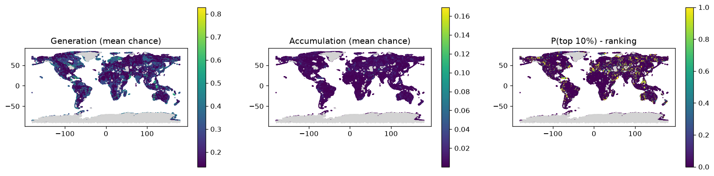

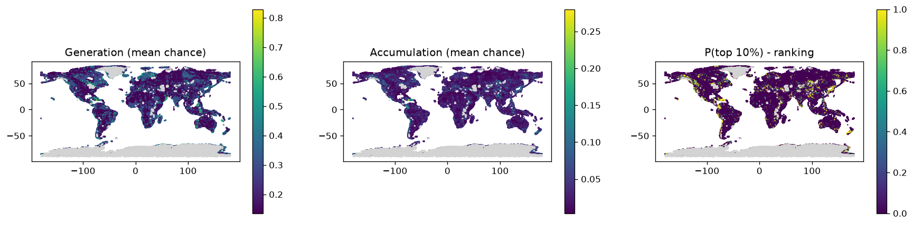

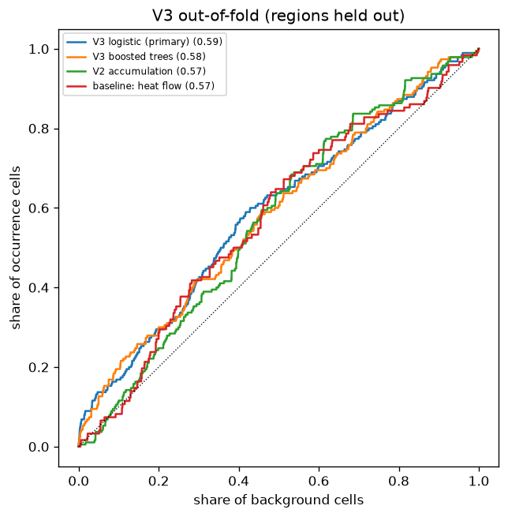

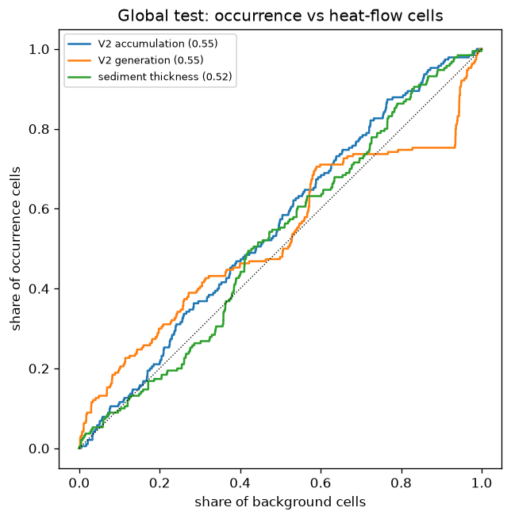

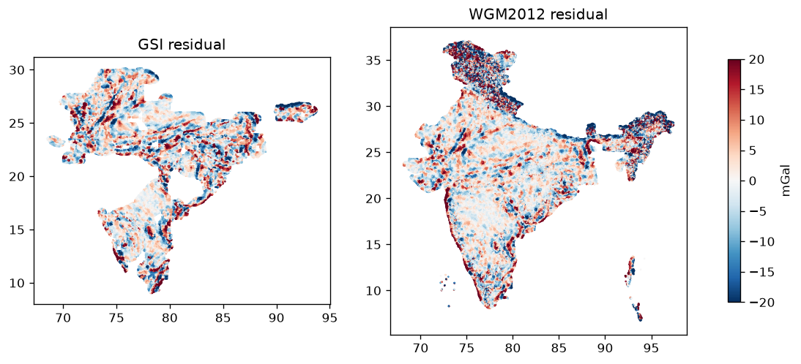

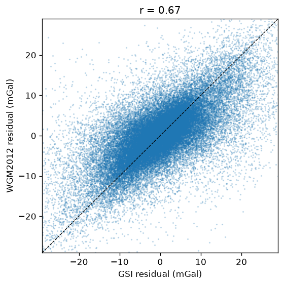

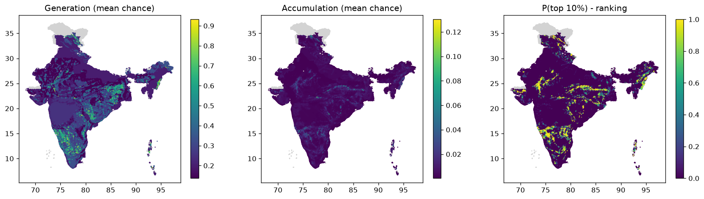

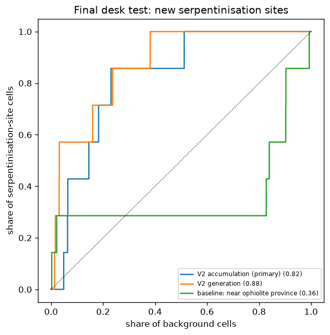

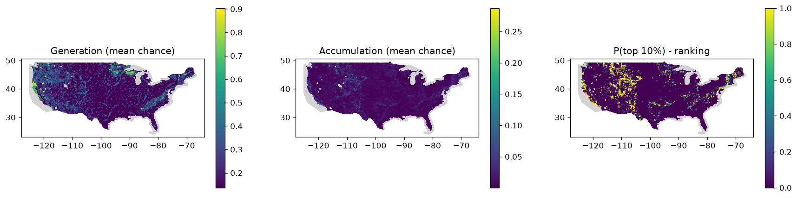

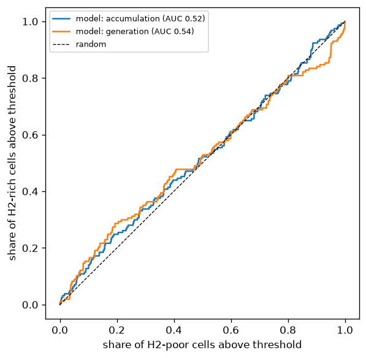

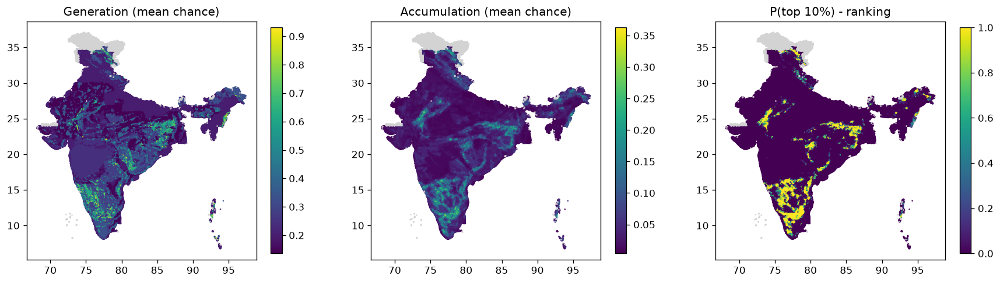


## Repository layout

```
src/h2pros/     shared code: H3 grid, overlays, great-circle distances
scripts/        India pipeline, run in number order (data download and audit, layers, scoring, evidence layers)
validation/     US, Australia and global validation scripts
configs/        scoring rules (V1.2 and V2), lithology classes, data layer list
metadata/       result reports and figures, published-literature tables, dataset register, decisions log
```

## Data (not included)

No data is in this repository. The scripts download public data or read it from `data_raw/`:
Geological Survey of India national datasets via the NGDR portal (free registration; single-user licence,
no redistribution), Central Ground Water Board groundwater quality, EPRI natural hydrogen occurrences,
USGS and Geoscience Australia gas analyses, GLiM global lithology, IHFC heat flow, Natural Earth.
See `metadata/dataset_register.csv` for sources, licences and versions. NGDR credentials are read only from
the environment variables NGDR_USER and NGDR_PASS.

Maps and figures derived from GSI data: Product of Geological Survey of India; reproduced by permission of
Director General on behalf of Government of India.

## Running

```
py -m venv .venv
.venv\Scripts\activate
pip install -r requirements.txt
```
Then the scripts in `scripts/` in number order; each prints what it needs and writes a report to `metadata/`.

## Licence

All rights reserved; published for viewing and evaluation (see LICENSE).
