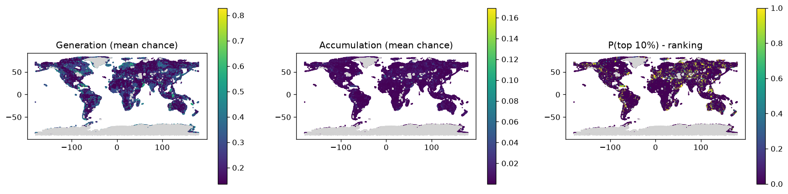

# Phase 4 scores - global, rules v1 (scoring_rules.yaml)

Rules: `configs/scoring_rules.yaml`. Runs: 1000. Cells scored: 539,303; no data: 49,169.
Ranking = share of runs in which a cell is in the top 10% of the global grid for accumulation (source + pathway + reservoir + seal + preservation).

## Spread of the main scores across scored cells

If charge is high almost everywhere, the source no longer separates cells (the v1 problem).

|        |   gen_mean |   charge_mean |   acc_mean |
|:-------|-----------:|--------------:|-----------:|
| p10    |      0.136 |         0.136 |      0.001 |
| median |      0.207 |         0.259 |      0.003 |
| p90    |      0.38  |         0.392 |      0.014 |
| p99    |      0.579 |         0.579 |      0.04  |

## Regional shortlist (cells in the top 10% in at least half the runs)

| state                 | tf_class                              |   cells |   mean_p_top |   max_p_top |   acc_mean |      lon |     lat |   area_km2 |
|:----------------------|:--------------------------------------|--------:|-------------:|------------:|-----------:|---------:|--------:|-----------:|
| Asia                  | Craton Cratonic                       |    2168 |        0.887 |           1 |      0.026 |   99.498 |  48.283 |     548296 |
| South America         | Orogenic Belt Terra Australis         |    1897 |        0.918 |           1 |      0.03  |  -71.526 |  -6.011 |     479759 |
| Asia                  | Volcanic Arc Kazakhstan               |    1316 |        0.885 |           1 |      0.026 |   71.913 |  51.186 |     332821 |
| Australia             | Orogenic Belt Terra Australis         |    1310 |        0.842 |           1 |      0.023 |  138.296 | -26.511 |     331304 |
| Asia                  | Orogenic Belt Kazakhstan              |    1268 |        0.896 |           1 |      0.028 |   79.32  |  44.049 |     320682 |
| Europe                | Orogenic Belt Variscan-Hercynian      |    1191 |        0.904 |           1 |      0.028 |    1.61  |  44.753 |     301208 |
| Australia             | Orogenic Belt Kuunga                  |    1075 |        0.894 |           1 |      0.027 |  119.552 | -24.904 |     271872 |
| Europe                | Orogenic Belt Uralian                 |    1017 |        0.854 |           1 |      0.024 |   56.384 |  60.742 |     257203 |
| North America         | Orogenic Belt Cordilleran             |     958 |        0.896 |           1 |      0.026 | -107.35  |  55.284 |     242282 |
| India and Middle East | Accretionary Complex Alpine-Himalayan |     946 |        0.895 |           1 |      0.026 |   51.129 |  32.838 |     239247 |
| North America         | Volcanic Arc Cordilleran              |     938 |        0.878 |           1 |      0.026 | -132.677 |  52.218 |     237224 |
| Asia                  | Shield Inner-Nunanian                 |     937 |        0.886 |           1 |      0.026 |  116.187 |  55.405 |     236971 |
| India and Middle East | Basin East African                    |     832 |        0.873 |           1 |      0.024 |   45.646 |  23.98  |     210416 |
| India and Middle East | Orogenic Belt Alpine-Himalayan        |     812 |        0.865 |           1 |      0.024 |   60.568 |  32.734 |     205358 |
| North America         | Craton Cratonic                       |     784 |        0.864 |           1 |      0.023 |  -98.243 |  51.231 |     198277 |
| Australia             | Shield Circum-Nunanian                |     742 |        0.85  |           1 |      0.023 |  134.397 | -19.961 |     187655 |
| Asia                  | Volcanic Arc Mongolian                |     705 |        0.883 |           1 |      0.025 |  103.746 |  48.227 |     178297 |
| Asia                  | Orogenic Belt Alpine-Himalayan        |     640 |        0.834 |           1 |      0.023 |   81.927 |  34.698 |     161858 |
| South America         | Volcanic Arc Terra Australis          |     622 |        0.909 |           1 |      0.033 |  -73.395 | -20.107 |     157306 |
| Asia                  | Orogenic Belt Yenisey                 |     611 |        0.874 |           1 |      0.025 |   90.982 |  63.007 |     154524 |
| North America         | Volcanic Arc Circum-Nunanian          |     605 |        0.86  |           1 |      0.023 |  -95.673 |  39.934 |     153007 |
| Australia             | Orogenic Belt Albany-Wilkes           |     595 |        0.87  |           1 |      0.025 |  122.825 | -26.757 |     150478 |
| Europe                | Accretionary Complex Alpine-Himalayan |     594 |        0.836 |           1 |      0.023 |   19.524 |  41.267 |     150225 |
| North America         | Passive Margin Cordilleran            |     593 |        0.907 |           1 |      0.026 | -133.388 |  59.369 |     149972 |
| India and Middle East | Ophiolite Complex East African        |     568 |        0.977 |           1 |      0.042 |   56.44  |  20.048 |     143649 |

## Generation fairway: cells in the top 10% for source in >= half the runs, by state

| state                 |   cells |
|:----------------------|--------:|
| North America         |   11274 |
| Asia                  |    9477 |
| South America         |    7167 |
| Africa                |    6173 |
| Europe                |    4977 |
| India and Middle East |    3851 |
| Australia             |    2734 |
| Southeast Asia        |    2641 |
| Antarctica            |    1832 |
| Zealandia             |     288 |
| unknown               |     254 |

## Top 30 cells

|   rank_acc | h3              | state                 |        lon |      lat |   p_top1_acc |   p_top_acc |   acc_mean |   gen_mean |   charge_mean |   mig_mean |   res_mean |   seal_mean |   pres_mean | main_class   | tf_class                       |
|-----------:|:----------------|:----------------------|-----------:|---------:|-------------:|------------:|-----------:|-----------:|--------------:|-----------:|-----------:|------------:|------------:|:-------------|:-------------------------------|
|          1 | 850d69b7fffffff | North America         | -132.493   |  65.2337 |            1 |           1 |     0.1693 |     0.6429 |        0.6429 |     0.5764 |     0.7473 |      0.852  |      0.7175 | SH           | Orogenic Belt Cordilleran      |
|          2 | 85438c3bfffffff | India and Middle East |   58.3718  |  23.6073 |            1 |           1 |     0.1623 |     0.6367 |        0.6367 |     0.5764 |     0.7473 |      0.8256 |      0.7175 | QUAT         | Ophiolite Complex East African |
|          3 | 85524d2bfffffff | India and Middle East |   53.8201  |  16.9791 |            1 |           1 |     0.1421 |     0.6367 |        0.6367 |     0.5764 |     0.6334 |      0.852  |      0.7175 | SH           | Ophiolite Complex East African |
|          4 | 8543adc7fffffff | India and Middle East |   56.4146  |  26.0254 |            1 |           1 |     0.1402 |     0.6367 |        0.6367 |     0.5764 |     0.7473 |      0.7133 |      0.7175 | CARB         | Ophiolite Complex East African |
|          4 | 850480b3fffffff | Asia                  |  141.57    |  67.3041 |            1 |           1 |     0.1402 |     0.6367 |        0.6367 |     0.5764 |     0.7473 |      0.7133 |      0.7175 | CARB         | Ophiolite Complex Cordilleran  |
|          4 | 8543ad8bfffffff | India and Middle East |   56.3906  |  26.1702 |            1 |           1 |     0.1402 |     0.6367 |        0.6367 |     0.5764 |     0.7473 |      0.7133 |      0.7175 | CARB         | Ophiolite Complex East African |
|          4 | 85438c2bfffffff | India and Middle East |   58.5233  |  23.5426 |            1 |           1 |     0.1402 |     0.6367 |        0.6367 |     0.5764 |     0.7473 |      0.7133 |      0.7175 | CARB         | Ophiolite Complex East African |
|          4 | 85438893fffffff | India and Middle East |   58.6747  |  23.4779 |            1 |           1 |     0.1402 |     0.6367 |        0.6367 |     0.5764 |     0.7473 |      0.7133 |      0.7175 | CARB         | Ophiolite Complex East African |
|          4 | 8543adcffffffff | India and Middle East |   56.4385  |  25.8809 |            1 |           1 |     0.1402 |     0.6367 |        0.6367 |     0.5764 |     0.7473 |      0.7133 |      0.7175 | CARB         | Ophiolite Complex East African |
|         10 | 8564867bfffffff | Southeast Asia        |   99.5655  |  18.531  |            1 |           1 |     0.1398 |     0.6367 |        0.6367 |     0.7888 |     0.5967 |      0.7904 |      0.5902 | CARB         | Ophiolite Complex Indosinian   |
|         11 | 853d6d67fffffff | Asia                  |   91.1954  |  39.1796 |            1 |           1 |     0.1338 |     0.5498 |        0.5498 |     0.7888 |     0.7322 |      0.7133 |      0.5902 | GRAN         | Craton Cratonic                |
|         12 | 85048a53fffffff | Asia                  |  147.686   |  65.4377 |            1 |           1 |     0.1333 |     0.5059 |        0.5068 |     0.5764 |     0.7473 |      0.852  |      0.7175 | SH           | Ophiolite Complex Cordilleran  |
|         13 | 85439ddbfffffff | India and Middle East |   57.8254  |  21.4942 |            1 |           1 |     0.133  |     0.5059 |        0.5059 |     0.5764 |     0.7473 |      0.852  |      0.7175 | SST          | Ophiolite Complex East African |
|         13 | 854385abfffffff | India and Middle East |   56.2227  |  23.7142 |            1 |           1 |     0.133  |     0.5059 |        0.5059 |     0.5764 |     0.7473 |      0.852  |      0.7175 | SH           | Passive Margin East African    |
|         13 | 85438bdbfffffff | India and Middle East |   59.6448  |  22.5268 |            1 |           1 |     0.133  |     0.5059 |        0.5059 |     0.5764 |     0.7473 |      0.852  |      0.7175 | SH           | Ophiolite Complex East African |
|         16 | 85a71e07fffffff | Australia             |  115.654   | -27.1168 |            1 |           1 |     0.13   |     0.6429 |        0.6429 |     0.7546 |     0.7473 |      0.7615 |      0.471  | QUAT         | Craton Cratonic                |
|         17 | 8517244ffffffff | Asia                  |  150.207   |  64.4099 |            1 |           1 |     0.124  |     0.6367 |        0.6367 |     0.5764 |     0.5967 |      0.7904 |      0.7175 | CARB         | Shield Cordilleran             |
|         17 | 851726affffffff | Asia                  |  150.635   |  64.0203 |            1 |           1 |     0.124  |     0.6367 |        0.6367 |     0.5764 |     0.5967 |      0.7904 |      0.7175 | CARB         | Shield Cordilleran             |
|         19 | 85438bcbfffffff | India and Middle East |   59.7936  |  22.4614 |            1 |           1 |     0.1234 |     0.5059 |        0.5059 |     0.5764 |     0.7473 |      0.7904 |      0.7175 | CARB         | Foredeep Basin East African    |
|         19 | 85439dd3fffffff | India and Middle East |   57.8058  |  21.6305 |            1 |           1 |     0.1234 |     0.5059 |        0.5059 |     0.5764 |     0.7473 |      0.7904 |      0.7175 | SST          | Passive Margin East African    |
|         21 | 853e689bfffffff | unknown               |   34.9679  |  29.7274 |            1 |           1 |     0.1211 |     0.488  |        0.488  |     0.7888 |     0.7473 |      0.7133 |      0.5902 | CARB         | Narrow Rift Afar               |
|         22 | 8504854bfffffff | Asia                  |  141.223   |  67.4045 |            1 |           1 |     0.1189 |     0.5059 |        0.5059 |     0.5764 |     0.7473 |      0.7615 |      0.7175 | QUAT         | Ophiolite Complex Cordilleran  |
|         22 | 8543aca7fffffff | India and Middle East |   55.9915  |  25.9256 |            1 |           1 |     0.1189 |     0.5059 |        0.5059 |     0.5764 |     0.7473 |      0.7615 |      0.7175 | QUAT         | Ophiolite Complex East African |
|         24 | 85438ab7fffffff | India and Middle East |   59.3465  |  22.6572 |            1 |           1 |     0.1185 |     0.6367 |        0.6367 |     0.408  |     0.7473 |      0.852  |      0.7175 | CARB         | Ophiolite Complex East African |
|         24 | 854388c7fffffff | India and Middle East |   58.862   |  23.1319 |            1 |           1 |     0.1185 |     0.6367 |        0.6367 |     0.408  |     0.7473 |      0.852  |      0.7175 | CARB         | Ophiolite Complex East African |
|         26 | 850a5cc7fffffff | Asia                  |  101.187   |  70.5256 |            1 |           1 |     0.1165 |     0.477  |        0.477  |     0.5764 |     0.7473 |      0.7904 |      0.7175 | CARB         | Craton Cratonic                |
|         27 | 8552ee17fffffff | India and Middle East |   47.3449  |  13.9973 |            1 |           1 |     0.1162 |     0.5202 |        0.5202 |     0.5764 |     0.6334 |      0.852  |      0.7175 | SH           | Basin East African             |
|         28 | 8539101bfffffff | Europe                |   -9.01989 |  37.1077 |            1 |           1 |     0.1146 |     0.4167 |        0.4167 |     0.7888 |     0.7473 |      0.7904 |      0.5902 | GNS          | Passive Margin                 |
|         29 | 8539226bfffffff | Europe                |   -8.5107  |  40.7136 |            1 |           1 |     0.1138 |     0.4677 |        0.4677 |     0.7888 |     0.7322 |      0.7133 |      0.5902 | GNS          | Passive Margin                 |
|         30 | 8520848ffffffff | Asia                  |   69.567   |  38.7064 |            1 |           1 |     0.1135 |     0.4677 |        0.4677 |     0.7888 |     0.6112 |      0.852  |      0.5902 | GRAN         | Orogenic Belt Kazakhstan       |

## How often each rule fired (scored cells)

| component    | factor                 | rule    | when                                                                                                   | cos (low/mode/high)   |   cells |
|:-------------|:-----------------------|:--------|:-------------------------------------------------------------------------------------------------------|:----------------------|--------:|
| generation   | serpentinisation       | 1       | km2_UM_main >= 2                                                                                       | 0.60/0.80/0.95        |       0 |
| generation   | serpentinisation       | 2       | n_um_strong >= 1                                                                                       | 0.55/0.75/0.90        |       0 |
| generation   | serpentinisation       | 3       | km2_UM_any >= 2                                                                                        | 0.40/0.60/0.80        |       0 |
| generation   | serpentinisation       | 4       | km2_UM_any > 0                                                                                         | 0.25/0.45/0.65        |       0 |
| generation   | serpentinisation       | 5       | tf_ophiolite >= 0.1                                                                                    | 0.25/0.45/0.65        |    4546 |
| generation   | serpentinisation       | 6       | any_UMA > 0 or n_um_moderate >= 1                                                                      | 0.15/0.30/0.50        |       0 |
| generation   | serpentinisation       | 7       | tf_greenstone >= 0.2                                                                                   | 0.10/0.25/0.40        |    1332 |
| generation   | serpentinisation       | 8       | f_MAF_I >= 0.05                                                                                        | 0.08/0.20/0.35        |   14134 |
| generation   | serpentinisation       | default | (default)                                                                                              | 0.01/0.03/0.08        |  519291 |
| generation   | iron_oxidation         | 1       | any_BIF > 0                                                                                            | 0.25/0.45/0.65        |    5759 |
| generation   | iron_oxidation         | 2       | f_MAF_V >= 0.2                                                                                         | 0.10/0.20/0.35        |   44691 |
| generation   | iron_oxidation         | 3       | f_MAF_D >= 0.5                                                                                         | 0.03/0.08/0.15        |     563 |
| generation   | iron_oxidation         | default | (default)                                                                                              | 0.01/0.02/0.05        |  488290 |
| generation   | radiolysis             | 1       | f_crystalline >= 0.5                                                                                   | 0.08/0.18/0.30        |  102284 |
| generation   | radiolysis             | 2       | f_crystalline >= 0.1                                                                                   | 0.04/0.10/0.18        |   49711 |
| generation   | radiolysis             | default | (default)                                                                                              | 0.01/0.02/0.05        |  387308 |
| generation   | dense_body             | 1       | g_res != g_res                                                                                         | 0.02/0.08/0.25        |       0 |
| generation   | dense_body             | 2       | g_res >= 10                                                                                            | 0.15/0.30/0.45        |   64331 |
| generation   | dense_body             | 3       | g_res >= 5                                                                                             | 0.08/0.18/0.30        |   68616 |
| generation   | dense_body             | default | (default)                                                                                              | 0.01/0.04/0.10        |  406356 |
| migration    | basement_faults        | 1       | d_fault_basement <= 5                                                                                  | 0.50/0.70/0.85        |    2919 |
| migration    | basement_faults        | 2       | d_fault_basement <= 15                                                                                 | 0.30/0.50/0.65        |    9150 |
| migration    | basement_faults        | 3       | d_fault_basement <= 30                                                                                 | 0.15/0.30/0.45        |   13193 |
| migration    | basement_faults        | default | (default)                                                                                              | 0.03/0.10/0.20        |  514041 |
| migration    | crustal_zones          | 1       | d_crustal_zone <= 10                                                                                   | 0.30/0.50/0.70        |   70464 |
| migration    | crustal_zones          | 2       | d_crustal_zone <= 25                                                                                   | 0.15/0.30/0.45        |   89209 |
| migration    | crustal_zones          | default | (default)                                                                                              | 0.01/0.03/0.08        |  379630 |
| migration    | other_faults           | 1       | d_fault_any <= 5                                                                                       | 0.15/0.30/0.45        |   16428 |
| migration    | other_faults           | 2       | d_fault_any <= 15                                                                                      | 0.08/0.18/0.30        |   26829 |
| migration    | other_faults           | default | (default)                                                                                              | 0.01/0.05/0.10        |  496046 |
| reservoir    | sedimentary            | 1       | f_sed_reservoir >= 0.3                                                                                 | 0.35/0.55/0.75        |  154356 |
| reservoir    | sedimentary            | 2       | f_sed_reservoir >= 0.1                                                                                 | 0.20/0.35/0.50        |   47487 |
| reservoir    | sedimentary            | default | (default)                                                                                              | 0.01/0.05/0.10        |  337460 |
| reservoir    | basin_depth            | 1       | bd_depth_m >= 500 and bd_depth_m <= 6000                                                               | 0.25/0.40/0.60        |  263801 |
| reservoir    | basin_depth            | 2       | bd_depth_m > 6000                                                                                      | 0.15/0.25/0.40        |   18481 |
| reservoir    | basin_depth            | default | (default)                                                                                              | 0.01/0.05/0.15        |  257021 |
| reservoir    | fractured_basement     | 1       | f_hardrock >= 0.5 and d_fault_any <= 10                                                                | 0.15/0.30/0.45        |    5605 |
| reservoir    | fractured_basement     | 2       | f_hardrock >= 0.5                                                                                      | 0.05/0.12/0.20        |  134377 |
| reservoir    | fractured_basement     | default | (default)                                                                                              | 0.01/0.03/0.08        |  399321 |
| seal         | evaporite              | 1       | any_EVAP >= 0.05                                                                                       | 0.50/0.70/0.85        |   47019 |
| seal         | evaporite              | default | (default)                                                                                              | 0.00/0.01/0.03        |  492284 |
| seal         | shale                  | 1       | f_SH >= 0.3                                                                                            | 0.30/0.50/0.70        |  121928 |
| seal         | shale                  | 2       | f_SH >= 0.1                                                                                            | 0.15/0.30/0.45        |   39358 |
| seal         | shale                  | default | (default)                                                                                              | 0.01/0.03/0.08        |  378017 |
| seal         | low_permeability_cover | 1       | f_MAF_D >= 0.5                                                                                         | 0.15/0.30/0.45        |     574 |
| seal         | low_permeability_cover | 2       | f_QUAT >= 0.5 and bd_depth_m >= 500                                                                    | 0.10/0.20/0.35        |  104306 |
| seal         | low_permeability_cover | 3       | f_MSED >= 0.3                                                                                          | 0.08/0.18/0.30        |    1613 |
| seal         | low_permeability_cover | default | (default)                                                                                              | 0.01/0.05/0.12        |  432810 |
| preservation | tectonic_stability     | 1       | d_neotectonic <= 5                                                                                     | 0.30/0.50/0.70        |   16428 |
| preservation | tectonic_stability     | 2       | d_neotectonic <= 15                                                                                    | 0.45/0.65/0.80        |   26829 |
| preservation | tectonic_stability     | default | (default)                                                                                              | 0.60/0.80/0.90        |  496046 |
| preservation | orogenic_activity      | 1       | tf_class.str.contains('Himalaya\|Accretionary\|Accreted\|Schuppen\|Eastern Boundary Thrust', na=False) | 0.40/0.60/0.80        |   67823 |
| preservation | orogenic_activity      | default | (default)                                                                                              | 0.85/0.95/1.00        |  471480 |

