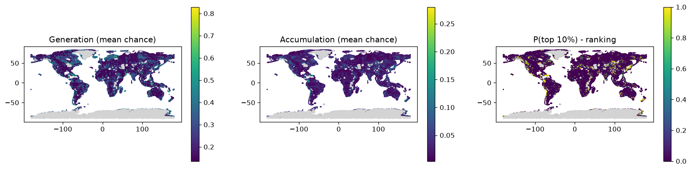

# Phase 4 scores - global, rules v2 (scoring_rules_v2.yaml)

Rules: `configs/scoring_rules_v2.yaml`. Runs: 1000. Cells scored: 539,303; no data: 49,169.
Ranking = share of runs in which a cell is in the top 10% of the global grid for accumulation (source + pathway + reservoir + seal + preservation).

## Spread of the main scores across scored cells

If charge is high almost everywhere, the source no longer separates cells (the v1 problem).

|        |   gen_mean |   charge_mean |   acc_mean |
|:-------|-----------:|--------------:|-----------:|
| p10    |      0.136 |         0.136 |      0.008 |
| median |      0.207 |         0.262 |      0.024 |
| p90    |      0.382 |         0.393 |      0.071 |
| p99    |      0.579 |         0.58  |      0.135 |

## Regional shortlist (cells in the top 10% in at least half the runs)

| state                 | tf_class                              |   cells |   mean_p_top |   max_p_top |   acc_mean |      lon |     lat |   area_km2 |
|:----------------------|:--------------------------------------|--------:|-------------:|------------:|-----------:|---------:|--------:|-----------:|
| North America         | Volcanic Arc Cordilleran              |    3016 |        0.898 |           1 |      0.1   | -124.853 |  46.616 |     762758 |
| North America         | Craton Cratonic                       |    1876 |        0.847 |           1 |      0.1   |  -85.602 |  53.759 |     474448 |
| Asia                  | Volcanic Arc Alpine-Himalayan         |    1421 |        0.898 |           1 |      0.103 |   89.127 |  34.147 |     359376 |
| North America         | Accretionary Complex Cordilleran      |    1316 |        0.895 |           1 |      0.101 | -121.094 |  42.348 |     332821 |
| South America         | Volcanic Arc Terra Australis          |    1250 |        0.915 |           1 |      0.105 |  -74.051 | -23.704 |     316130 |
| Asia                  | Volcanic Arc Mongolian                |    1083 |        0.874 |           1 |      0.097 |  103.727 |  49.546 |     273895 |
| South America         | Accretionary Complex Terra Australis  |    1078 |        0.927 |           1 |      0.11  |  -73.868 | -19.216 |     272630 |
| Africa                | Volcanic Arc East African             |    1020 |        0.864 |           1 |      0.098 |   36.553 |   9.826 |     257962 |
| Africa                | Orogenic Belt East African            |     920 |        0.834 |           1 |      0.093 |   35.963 | -14.119 |     232672 |
| North America         | Wide Rift Cordilleran                 |     909 |        0.874 |           1 |      0.097 | -116.385 |  39.297 |     229890 |
| Asia                  | Orogenic Belt Alpine-Himalayan        |     898 |        0.884 |           1 |      0.1   |   85.433 |  32.979 |     227108 |
| Asia                  | Volcanic Arc Cordilleran              |     882 |        0.897 |           1 |      0.101 |  142.598 |  44.726 |     223061 |
| Asia                  | Accretionary Complex Mongolian        |     860 |        0.85  |           1 |      0.093 |  101.542 |  48.425 |     217497 |
| South America         | Orogenic Belt Terra Australis         |     846 |        0.902 |           1 |      0.105 |  -73.013 |   0.207 |     213957 |
| Africa                | Narrow Rift Afar                      |     842 |        0.926 |           1 |      0.109 |   36.496 |   2.648 |     212945 |
| India and Middle East | Accretionary Complex Alpine-Himalayan |     795 |        0.888 |           1 |      0.101 |   50.474 |  33.314 |     201059 |
| Europe                | Accretionary Complex Alpine-Himalayan |     754 |        0.891 |           1 |      0.1   |   20.463 |  42.368 |     190690 |
| Africa                | Craton Cratonic                       |     699 |        0.816 |           1 |      0.091 |   30.513 | -10.391 |     176780 |
| Asia                  | Orogenic Belt Kazakhstan              |     689 |        0.847 |           1 |      0.092 |   82.323 |  44.045 |     174251 |
| North America         | Passive Margin Cordilleran            |     664 |        0.883 |           1 |      0.095 | -131.825 |  58.908 |     167928 |
| Europe                | Volcanic Arc Alpine-Himalayan         |     659 |        0.89  |           1 |      0.1   |   33.621 |  41.885 |     166664 |
| Australia             | Craton Cratonic                       |     639 |        0.912 |           1 |      0.11  |  118.363 | -29.546 |     161606 |
| Asia                  | Orogenic Belt Mongolian               |     632 |        0.916 |           1 |      0.107 |  100.908 |  50.794 |     159835 |
| South America         | Orogenic Belt Brasiliano              |     626 |        0.829 |           1 |      0.094 |  -48.523 | -20.253 |     158318 |
| India and Middle East | Volcanic Arc Alpine-Himalayan         |     580 |        0.893 |           1 |      0.1   |   50.688 |  35.627 |     146684 |

## Generation fairway: cells in the top 10% for source in >= half the runs, by state

| state                 |   cells |
|:----------------------|--------:|
| North America         |   13366 |
| Asia                  |   11360 |
| Africa                |   10437 |
| South America         |    8353 |
| Europe                |    5689 |
| India and Middle East |    4182 |
| Australia             |    2851 |
| Southeast Asia        |    2826 |
| Antarctica            |    2170 |
| Zealandia             |     303 |
| unknown               |     254 |

## Top 30 cells

|   rank_acc | h3              | state          |       lon |     lat |   p_top1_acc |   p_top_acc |   acc_mean |   gen_mean |   charge_mean |   mig_mean |   cover_mean | main_class   | tf_class                                    |
|-----------:|:----------------|:---------------|----------:|--------:|-------------:|------------:|-----------:|-----------:|--------------:|-----------:|-------------:|:-------------|:--------------------------------------------|
|          1 | 850c6c6ffffffff | North America  | -141.697  | 60.4969 |            1 |           1 |     0.28   |     0.7067 |        0.7067 |     0.8879 |       0.4463 | MAF_V        | Accretionary Complex Cordilleran            |
|          1 | 850c6893fffffff | North America  | -141.235  | 60.4289 |            1 |           1 |     0.28   |     0.7067 |        0.7067 |     0.8879 |       0.4463 | MAF_V        | Ophiolite Complex Cordilleran               |
|          3 | 856d29c3fffffff | North America  |  -90.6998 | 14.8991 |            1 |           1 |     0.2762 |     0.697  |        0.697  |     0.8879 |       0.4463 | GNS          | Volcanic Arc Cordilleran                    |
|          3 | 85404acbfffffff | Southeast Asia |   98.3095 | 26.838  |            1 |           1 |     0.2762 |     0.697  |        0.697  |     0.8879 |       0.4463 | GNS          | Volcanic Arc Alpine-Himalayan               |
|          3 | 856d2987fffffff | North America  |  -90.1612 | 14.8246 |            1 |           1 |     0.2762 |     0.697  |        0.697  |     0.8879 |       0.4463 | GNS          | Ophiolite Complex Cordilleran               |
|          3 | 854066c7fffffff | Southeast Asia |  103.636  | 22.8609 |            1 |           1 |     0.2762 |     0.697  |        0.697  |     0.8879 |       0.4463 | GNS          | Orogenic Belt Indosinian                    |
|          3 | 8540660ffffffff | Southeast Asia |  103.223  | 23.0649 |            1 |           1 |     0.2762 |     0.697  |        0.697  |     0.8879 |       0.4463 | GNS          | Ophiolite Complex Indosinian                |
|          3 | 8540438ffffffff | Southeast Asia |   99.9663 | 25.9328 |            1 |           1 |     0.2762 |     0.697  |        0.697  |     0.8879 |       0.4463 | GNS          | Volcanic Arc Indosinian                     |
|          3 | 854525a3fffffff | North America  |  -89.8628 | 14.9419 |            1 |           1 |     0.2762 |     0.697  |        0.697  |     0.8879 |       0.4463 | GNS          | Volcanic Arc Cordilleran                    |
|         10 | 856720dbfffffff | North America  |  -73.3865 | 18.3999 |            1 |           1 |     0.2662 |     0.7067 |        0.7067 |     0.8443 |       0.4463 | MAF_V        | Ophiolite Complex Antilles                  |
|         10 | 856735b7fffffff | North America  |  -74.3232 | 18.3472 |            1 |           1 |     0.2662 |     0.7067 |        0.7067 |     0.8443 |       0.4463 | MAF_V        | Ophiolite Complex Antilles                  |
|         12 | 85404563fffffff | Southeast Asia |  100.221  | 24.7265 |            1 |           1 |     0.2626 |     0.697  |        0.697  |     0.8443 |       0.4463 | GNS          | Ophiolite Complex Indosinian                |
|         13 | 850c6e07fffffff | North America  | -142.922  | 60.5952 |            1 |           1 |     0.2614 |     0.6597 |        0.6597 |     0.8879 |       0.4463 | MAF_V        | Ophiolite Complex Cordilleran               |
|         14 | 85404caffffffff | Southeast Asia |   97.9353 | 24.6629 |            1 |           1 |     0.2606 |     0.7822 |        0.7822 |     0.7464 |       0.4463 | QUAT         | Ophiolite Complex Alpine-Himalayan          |
|         15 | 85649147fffffff | Southeast Asia |   99.1626 | 20.3433 |            1 |           1 |     0.2571 |     0.6485 |        0.6485 |     0.8879 |       0.4463 | GRAN         | Ophiolite Complex Indosinian                |
|         15 | 85404ca3fffffff | Southeast Asia |   98.0611 | 24.5494 |            1 |           1 |     0.2571 |     0.6485 |        0.6485 |     0.8879 |       0.4463 | GNS          | Ophiolite Complex Alpine-Himalayan          |
|         15 | 854525b7fffffff | North America  |  -90.0119 | 14.8833 |            1 |           1 |     0.2571 |     0.6485 |        0.6485 |     0.8879 |       0.4463 | GNS          | Volcanic Arc Cordilleran                    |
|         18 | 851391c3fffffff | North America  | -135.802  | 59.3854 |            1 |           1 |     0.2557 |     0.6457 |        0.6457 |     0.8879 |       0.4463 | GRAN         | Volcanic Arc Cordilleran                    |
|         18 | 85674cd7fffffff | South America  |  -66.4395 | 10.6359 |            1 |           1 |     0.2557 |     0.6457 |        0.6457 |     0.8879 |       0.4463 | GNS          | Orogenic Belt Terra Australis               |
|         20 | 8524b4abfffffff | Asia           |   93.381  | 39.1832 |            1 |           1 |     0.2541 |     0.6413 |        0.6413 |     0.8879 |       0.4463 | MAF_V        | Volcanic Arc Alpine-Himalayan               |
|         21 | 856d2913fffffff | North America  |  -90.46   | 14.7067 |            1 |           1 |     0.2514 |     0.6672 |        0.6672 |     0.8443 |       0.4463 | GNS          | Ophiolite Complex Cordilleran               |
|         22 | 85139687fffffff | North America  | -138.709  | 59.7843 |            1 |           1 |     0.2503 |     0.632  |        0.632  |     0.8879 |       0.4463 | MAF_V        | Volcanic Arc Cordilleran                    |
|         23 | 8567264ffffffff | North America  |  -74.31   | 18.4746 |            1 |           1 |     0.2488 |     0.7067 |        0.7067 |     0.7883 |       0.4463 | MAF_V        | Ophiolite Complex Antilles                  |
|         23 | 856735b3fffffff | North America  |  -74.448  | 18.4303 |            1 |           1 |     0.2488 |     0.7067 |        0.7067 |     0.7883 |       0.4463 | MAF_V        | Ophiolite Complex Antilles                  |
|         25 | 8567267bfffffff | North America  |  -74.1853 | 18.3915 |            1 |           1 |     0.2485 |     0.6597 |        0.6597 |     0.8443 |       0.4463 | MAF_V        | Ophiolite Complex Antilles                  |
|         25 | 85672553fffffff | North America  |  -72.4562 | 18.4477 |            1 |           1 |     0.2485 |     0.6597 |        0.6597 |     0.8443 |       0.4463 | MAF_V        | Ophiolite Complex Antilles                  |
|         27 | 85404c33fffffff | Southeast Asia |   97.9833 | 24.8145 |            1 |           1 |     0.2482 |     0.7451 |        0.7451 |     0.7464 |       0.4463 | CARB         | Ophiolite Complex Alpine-Himalayan          |
|         28 | 8524a347fffffff | Asia           |   97.0875 | 39.3982 |            1 |           1 |     0.2464 |     0.7001 |        0.7001 |     0.7883 |       0.4463 | SH           | Continental Back-Arc Basin Alpine-Himalayan |
|         28 | 8540eea7fffffff | Asia           |  102.062  | 30.119  |            1 |           1 |     0.2464 |     0.7001 |        0.7001 |     0.7883 |       0.4463 | GRAN         | Orogenic Belt Alpine-Himalayan              |
|         30 | 8540646bfffffff | Southeast Asia |  102.853  | 22.4244 |            1 |           1 |     0.2454 |     0.697  |        0.697  |     0.7883 |       0.4463 | GRAN         | Ophiolite Complex Indosinian                |

## How often each rule fired (scored cells)

| component   | factor           | rule    | when                                                                   | cos (low/mode/high)   |   cells |
|:------------|:-----------------|:--------|:-----------------------------------------------------------------------|:----------------------|--------:|
| generation  | serpentinisation | 1       | km2_UM_main >= 2                                                       | 0.60/0.80/0.95        |       0 |
| generation  | serpentinisation | 2       | n_um_strong >= 1                                                       | 0.55/0.75/0.90        |       0 |
| generation  | serpentinisation | 3       | km2_UM_any >= 2                                                        | 0.40/0.60/0.80        |       0 |
| generation  | serpentinisation | 4       | km2_UM_any > 0                                                         | 0.25/0.45/0.65        |       0 |
| generation  | serpentinisation | 5       | tf_ophiolite >= 0.1                                                    | 0.25/0.45/0.65        |    4546 |
| generation  | serpentinisation | 6       | any_UMA > 0 or n_um_moderate >= 1                                      | 0.15/0.30/0.50        |       0 |
| generation  | serpentinisation | 7       | tf_greenstone >= 0.2                                                   | 0.10/0.25/0.40        |    1332 |
| generation  | serpentinisation | 8       | f_MAF_I >= 0.05                                                        | 0.08/0.20/0.35        |   14134 |
| generation  | serpentinisation | default | (default)                                                              | 0.01/0.03/0.08        |  519291 |
| generation  | iron_oxidation   | 1       | any_BIF > 0                                                            | 0.25/0.45/0.65        |    5759 |
| generation  | iron_oxidation   | 2       | f_MAF_V >= 0.2                                                         | 0.10/0.20/0.35        |   44691 |
| generation  | iron_oxidation   | 3       | f_MAF_D >= 0.5                                                         | 0.03/0.08/0.15        |     563 |
| generation  | iron_oxidation   | default | (default)                                                              | 0.01/0.02/0.05        |  488290 |
| generation  | radiolysis       | 1       | f_crystalline >= 0.5                                                   | 0.08/0.18/0.30        |  102284 |
| generation  | radiolysis       | 2       | f_crystalline >= 0.1                                                   | 0.04/0.10/0.18        |   49711 |
| generation  | radiolysis       | default | (default)                                                              | 0.01/0.02/0.05        |  387308 |
| generation  | dense_body       | 1       | g_res != g_res                                                         | 0.02/0.08/0.25        |       0 |
| generation  | dense_body       | 2       | g_res >= 10                                                            | 0.15/0.30/0.45        |   64331 |
| generation  | dense_body       | 3       | g_res >= 5                                                             | 0.08/0.18/0.30        |   68616 |
| generation  | dense_body       | default | (default)                                                              | 0.01/0.04/0.10        |  406356 |
| migration   | basement_faults  | 1       | d_fault_basement <= 5                                                  | 0.50/0.70/0.85        |    2919 |
| migration   | basement_faults  | 2       | d_fault_basement <= 15                                                 | 0.30/0.50/0.65        |    9150 |
| migration   | basement_faults  | 3       | d_fault_basement <= 30                                                 | 0.15/0.30/0.45        |   13193 |
| migration   | basement_faults  | default | (default)                                                              | 0.03/0.10/0.20        |  514041 |
| migration   | crustal_zones    | 1       | d_crustal_zone <= 10                                                   | 0.30/0.50/0.70        |   70464 |
| migration   | crustal_zones    | 2       | d_crustal_zone <= 25                                                   | 0.15/0.30/0.45        |   89209 |
| migration   | crustal_zones    | default | (default)                                                              | 0.01/0.03/0.08        |  379630 |
| migration   | other_faults     | 1       | d_fault_any <= 5                                                       | 0.15/0.30/0.45        |   16428 |
| migration   | other_faults     | 2       | d_fault_any <= 15                                                      | 0.08/0.18/0.30        |   26829 |
| migration   | other_faults     | default | (default)                                                              | 0.01/0.05/0.10        |  496046 |
| cover       | thin_cover       | 1       | bd_depth_m <= 2000 or (bd_depth_m != bd_depth_m and f_hardrock >= 0.5) | 0.30/0.45/0.60        |  421935 |
| cover       | thin_cover       | 2       | bd_depth_m <= 4000                                                     | 0.15/0.30/0.45        |   71288 |
| cover       | thin_cover       | 3       | bd_depth_m > 4000                                                      | 0.05/0.12/0.25        |   46080 |
| cover       | thin_cover       | default | (default)                                                              | 0.10/0.25/0.40        |       0 |

