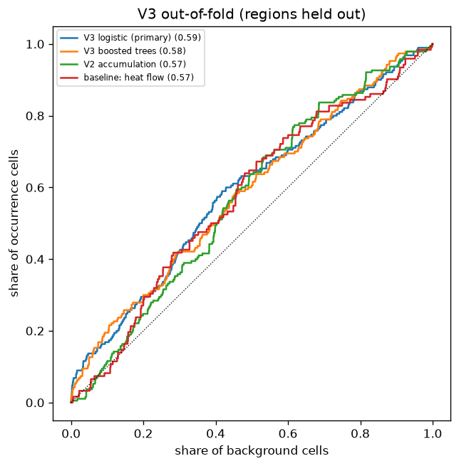

# V3: learned weights, tested on held-out regions (protocol 2026-11-03)

**Result: FAIL** - pooled out-of-fold AUC 0.589 (90% low 0.548); vs V2 +0.018 (90%: -0.029 to +0.065); vs best baseline (baseline: heat flow) +0.015 (-0.040 to +0.067); held-out regions with AUC > 0.5: 4 of 5 eligible.

Cells: 190 positive, 18,849 background. Scores are ranked within each region before pooling.

## Pooled out-of-fold

| score                             |   AUC |   90% low |   90% high |
|:----------------------------------|------:|----------:|-----------:|
| V3 logistic (primary)             | 0.589 |     0.548 |      0.629 |
| V3 boosted trees                  | 0.583 |     0.541 |      0.622 |
| V2 accumulation                   | 0.571 |     0.537 |      0.606 |
| baseline: near ophiolite province | 0.489 |     0.44  |      0.538 |
| baseline: sediment thickness      | 0.525 |     0.487 |      0.562 |
| baseline: heat flow               | 0.573 |     0.529 |      0.619 |

## Each region predicted by a model trained on the others

| held-out region   |   positive cells |   background |   V3 logistic |   V3 boosted trees |   V2 accumulation |   baseline: heat flow |
|:------------------|-----------------:|-------------:|--------------:|-------------------:|------------------:|----------------------:|
| Russia            |               98 |         1274 |         0.57  |              0.588 |             0.536 |                 0.561 |
| Europe            |               28 |         2819 |         0.483 |              0.552 |             0.477 |                 0.524 |
| Asia              |               29 |         2848 |         0.781 |              0.631 |             0.66  |                 0.735 |
| North America     |               18 |         9051 |         0.544 |              0.688 |             0.71  |                 0.503 |
| Rest              |               17 |         2857 |         0.614 |              0.443 |             0.624 |                 0.665 |

## Sensitivity: Russia removed entirely

| score                             |   AUC |   90% low |   90% high |
|:----------------------------------|------:|----------:|-----------:|
| V3 logistic (primary)             | 0.618 |     0.551 |      0.679 |
| V3 boosted trees                  | 0.596 |     0.545 |      0.649 |
| V2 accumulation                   | 0.607 |     0.556 |      0.658 |
| baseline: near ophiolite province | 0.45  |     0.384 |      0.523 |
| baseline: sediment thickness      | 0.539 |     0.487 |      0.588 |
| baseline: heat flow               | 0.585 |     0.525 |      0.649 |

| held-out region   |   positive cells |   background |   V3 logistic |   V3 boosted trees |   V2 accumulation |   baseline: heat flow |
|:------------------|-----------------:|-------------:|--------------:|-------------------:|------------------:|----------------------:|
| Europe            |               28 |         2819 |         0.464 |              0.576 |             0.477 |                 0.524 |
| Asia              |               29 |         2848 |         0.747 |              0.624 |             0.66  |                 0.735 |
| North America     |               18 |         9051 |         0.64  |              0.574 |             0.71  |                 0.503 |
| Rest              |               17 |         2857 |         0.629 |              0.607 |             0.624 |                 0.665 |

## Learned weights (logistic, all cells; standardised inputs - positive = more occurrences)

|                      |   weight |
|:---------------------|---------:|
| f_EVAP               |   -1.984 |
| f_MAF_D              |   -1.697 |
| log_d_um_rock        |    1.051 |
| log_d_fault_any      |    0.939 |
| tf_ophiolite         |    0.664 |
| log_d_thrust         |   -0.452 |
| log_d_fault_basement |   -0.443 |
| f_SH                 |    0.427 |
| f_VOLC               |   -0.298 |
| f_CARB               |    0.25  |
| f_MAF_I              |    0.245 |
| f_GNS                |   -0.182 |
| f_SST                |    0.158 |
| log_sed_m            |   -0.148 |
| tf_greenstone        |    0.141 |
| f_QUAT               |   -0.118 |
| tf_accretion         |    0.088 |
| f_GRAN               |   -0.069 |
| f_MSED               |    0.066 |
| f_MAF_V              |    0.049 |
| any_EVAP             |   -0.047 |
| log_d_suture         |   -0.029 |
| tf_rift              |    0.025 |
| any_BIF              |    0.016 |
| g_res                |   -0.015 |
| g_res_missing        |    0     |

## Exploratory: median percentile (within region) of occurrence cells, by EPRI Subcategory

50 = no better than a background cell. Not a test.

| sub                           |   records |   cells |   v3_median_pct |   v2_median_pct |
|:------------------------------|----------:|--------:|----------------:|----------------:|
| Aquifers                      |        54 |      54 |              65 |              51 |
| Sediments and Metamorphic     |        26 |      26 |              59 |              69 |
| Serpentinization              |        25 |      20 |              99 |              77 |
| Orebodies                     |        27 |      19 |              85 |              74 |
| Hydrocarbon fields            |        16 |      16 |              57 |              47 |
| Water from hydrocarbon fields |        15 |      15 |              35 |              30 |
| Salt Deposits                 |        12 |      12 |              65 |              43 |
| Coal Basins                   |        10 |      10 |              57 |              59 |
| Precambrian                   |        10 |       9 |              48 |              66 |
| Geysers, hot springs, etc.    |         4 |       4 |              50 |              63 |
| Faults                        |         3 |       3 |              16 |              91 |
| Other                         |         3 |       3 |              36 |              65 |
| Igneous                       |         3 |       3 |              88 |              81 |
| Kimberlites                   |         1 |       1 |               9 |              30 |
| Rift Zones                    |         2 |       1 |              82 |              55 |

No V3 map is produced (protocol: only on Pass or Partial).
