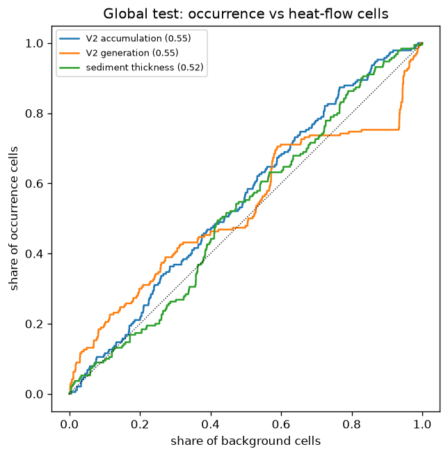

# Global test of the method (pre-registered 2026-11-03)

EPRI records 341; primary records 211 (Free Gas / Dissolved gas, not volcanic) -> 191 positive cells (res 5); 1 of them are not scored cells (no mapped geology) and drop out.
Background (primary): 18,849 scored cells with an onshore heat-flow site and no EPRI record.
**Result: FAIL** - V2 AUC 0.555 (90% low 0.522); margin over best baseline -0.075; outside-Russia AUC 0.648 (low 0.597).

## Primary: positive cells vs heat-flow cells

190 positive and 18,849 background cells in 3882 blocks.

| score                             |   AUC |   90% low |   90% high | note                                |
|:----------------------------------|------:|----------:|-----------:|:------------------------------------|
| V2 accumulation (primary)         | 0.555 |     0.522 |      0.592 |                                     |
| V2 generation                     | 0.551 |     0.511 |      0.593 |                                     |
| V1.2 accumulation                 | 0.579 |     0.54  |      0.62  |                                     |
| baseline: near ophiolite province | 0.617 |     0.572 |      0.66  | direction flipped (lower = more H2) |
| baseline: sediment thickness      | 0.521 |     0.483 |      0.559 | direction flipped (lower = more H2) |
| baseline: heat flow               | 0.63  |     0.588 |      0.676 | direction flipped (lower = more H2) |

Best baseline: **baseline: heat flow** (0.630). V2 minus best baseline: -0.075 (90%: -0.132 to -0.024).

Top-10% capture (global top 10% of scored cells): 12% of positive cells, 10% of background cells.

## Outside the Russian Federation

92 positive cells.

| score                             |   AUC |   90% low |   90% high | note                                |
|:----------------------------------|------:|----------:|-----------:|:------------------------------------|
| V2 accumulation (primary)         | 0.648 |     0.597 |      0.698 |                                     |
| V2 generation                     | 0.634 |     0.571 |      0.697 |                                     |
| V1.2 accumulation                 | 0.611 |     0.557 |      0.667 |                                     |
| baseline: near ophiolite province | 0.559 |     0.487 |      0.635 | direction flipped (lower = more H2) |
| baseline: sediment thickness      | 0.578 |     0.528 |      0.628 | direction flipped (lower = more H2) |
| baseline: heat flow               | 0.585 |     0.523 |      0.649 | direction flipped (lower = more H2) |

## Secondary: all scored land as background

| score                             |   AUC |   90% low |   90% high | note                                |
|:----------------------------------|------:|----------:|-----------:|:------------------------------------|
| V2 accumulation (primary)         | 0.504 |     0.461 |      0.545 |                                     |
| V2 generation                     | 0.495 |     0.453 |      0.539 |                                     |
| V1.2 accumulation                 | 0.649 |     0.609 |      0.687 |                                     |
| baseline: near ophiolite province | 0.539 |     0.499 |      0.577 | direction flipped (lower = more H2) |
| baseline: sediment thickness      | 0.632 |     0.594 |      0.67  |                                     |
| baseline: heat flow               | 0.583 |     0.541 |      0.624 | direction flipped (lower = more H2) |

## Secondary: fluid-inclusion records as positives

81 cells.

| score                             |   AUC |   90% low |   90% high | note                                |
|:----------------------------------|------:|----------:|-----------:|:------------------------------------|
| V2 accumulation (primary)         | 0.6   |     0.556 |      0.642 |                                     |
| V2 generation                     | 0.654 |     0.594 |      0.71  |                                     |
| V1.2 accumulation                 | 0.477 |     0.413 |      0.545 |                                     |
| baseline: near ophiolite province | 0.642 |     0.596 |      0.689 | direction flipped (lower = more H2) |
| baseline: sediment thickness      | 0.668 |     0.599 |      0.732 | direction flipped (lower = more H2) |
| baseline: heat flow               | 0.804 |     0.752 |      0.858 | direction flipped (lower = more H2) |

## Positive cells by country (concentration)

| country                  |   pos |   cells |
|:-------------------------|------:|--------:|
| Russia                   |    98 |    1372 |
| United States of America |    16 |    6466 |
| Oman                     |    11 |      29 |
| Germany                  |     8 |     329 |
| South Africa             |     5 |      81 |
| Ukraine                  |     5 |     419 |
| Kazakhstan               |     4 |     114 |
| Australia                |     4 |     460 |
| Belarus                  |     4 |     115 |
| Uzbekistan               |     3 |      74 |
| Finland                  |     3 |      38 |
| Kyrgyzstan               |     3 |      56 |

