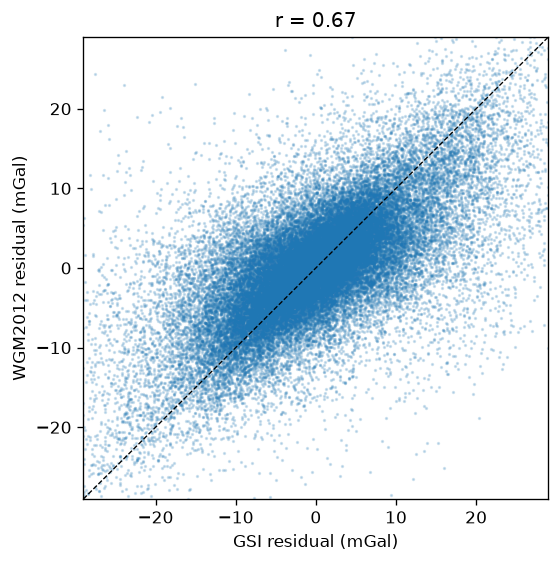
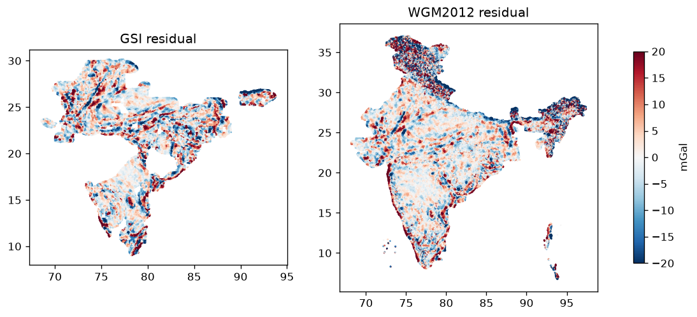

# Gravity: GSI ground stations vs WGM2012

GSI stations read 756,405, used 692,887. Cells with GSI gravity (>= 3 stations): 49,675 of 90,866; isolated jumps removed: 54.
Residual = cell minus mean within 50 km (needs >= 50% of the neighbourhood with data).

| comparison | cells | correlation r |
|:--|--:|--:|
| Bouguer anomaly (full) | 49,675 | 0.89 |
| Residual anomaly (what we score) | 48,271 | 0.67 |

**Decision rule (r >= 0.7): GSI where it exists; no gravity evidence elsewhere.**
Cells with gravity evidence: 48,271 of 90,866.

Residual correlation by state (states with >= 50 shared cells):

| state          |   cells |   r_residual |
|:---------------|--------:|-------------:|
| CHHATTISGARH   |    2335 |         0.2  |
| ODISHA         |    2567 |         0.35 |
| MEGHALAYA      |     478 |         0.45 |
| BIHAR          |    1164 |         0.47 |
| JHARKHAND      |    1958 |         0.5  |
| HARYANA        |    1035 |         0.53 |
| GOA            |     105 |         0.59 |
| ASSAM          |     872 |         0.63 |
| UTTAR PRADESH  |    2868 |         0.63 |
| KARNATAKA      |    4479 |         0.64 |
| TAMIL NADU     |    2423 |         0.64 |
| MAHARASHTRA    |    1226 |         0.68 |
| MADHYA PRADESH |    6954 |         0.72 |
| TELANGANA      |    2492 |         0.72 |
| WEST BENGAL    |    1440 |         0.75 |
| RAJASTHAN      |    8623 |         0.79 |
| PUNJAB         |     124 |         0.8  |
| KERALA         |     218 |         0.8  |
| ANDHRA PRADESH |    3463 |         0.82 |
| GUJARAT        |    3349 |         0.82 |

## Side check: cells with no mapped lithology, by state

| state             |   cells |
|:------------------|--------:|
| LADAKH            |    2797 |
| GUJARAT           |     205 |
| JAMMU AND KASHMIR |     199 |
| ARUNACHAL PRADESH |      33 |
| LAKSHADWEEP       |      28 |
| ANDAMAN & NICOBAR |      27 |
| SIKKIM            |      22 |
| RAJASTHAN         |      10 |
| WEST BENGAL       |       9 |
| UTTARAKHAND       |       7 |
| ODISHA            |       6 |
| ASSAM             |       6 |

