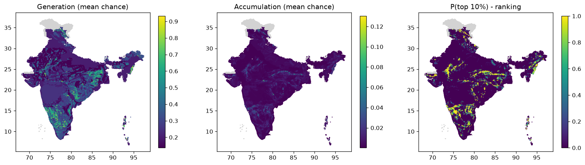

# Phase 4 scores - India

Rules: `configs/scoring_rules.yaml`. Runs: 1000. Cells scored: 87,495; no data: 3,371.
Ranking = share of runs in which a cell is in the top 10% of India for accumulation (source + pathway + reservoir + seal + preservation).

## Spread of the main scores across scored cells

If charge is high almost everywhere, the source no longer separates cells (the v1 problem).

|        |   gen_mean |   charge_mean |   acc_mean |
|:-------|-----------:|--------------:|-----------:|
| p10    |      0.137 |         0.2   |      0.001 |
| median |      0.249 |         0.292 |      0.003 |
| p90    |      0.417 |         0.569 |      0.011 |
| p99    |      0.728 |         0.761 |      0.033 |

## Regional shortlist (cells in the top 10% in at least half the runs)

| state          | tf_class                                                                                 |   cells |   mean_p_top |   max_p_top |   acc_mean |    lon |    lat |   area_km2 |
|:---------------|:-----------------------------------------------------------------------------------------|--------:|-------------:|------------:|-----------:|-------:|-------:|-----------:|
| KARNATAKA      | Greenstone and allied Supracrustal Belts of Southern-Central and Eastern India           |     663 |        0.907 |           1 |      0.023 | 75.542 | 14.739 |      23934 |
| ANDHRA PRADESH | Shelf facies cover in Intracratonic sag (including low - moderate strained Folded Cover) |     450 |        0.889 |           1 |      0.023 | 78.835 | 15.192 |      16245 |
| RAJASTHAN      | Proterozoic Fold Belt                                                                    |     390 |        0.928 |           1 |      0.024 | 73.981 | 24.96  |      14079 |
| KARNATAKA      | Unclassified Gneissic Complex                                                            |     340 |        0.794 |           1 |      0.017 | 75.939 | 14.84  |      12274 |
| MADHYA PRADESH | Shelf facies cover in Intracratonic sag (including low - moderate strained Folded Cover) |     288 |        0.865 |           1 |      0.023 | 80.196 | 24.27  |      10397 |
| JHARKHAND      | Unclassified Gneissic Complex                                                            |     216 |        0.822 |           1 |      0.019 | 84.97  | 23.903 |       7798 |
| TAMIL NADU     | Unclassified Gneissic Complex                                                            |     213 |        0.813 |           1 |      0.015 | 78.058 | 11.472 |       7689 |
| RAJASTHAN      | Shelf facies cover in Intracratonic sag (including low - moderate strained Folded Cover) |     176 |        0.863 |           1 |      0.02  | 75.853 | 25.524 |       6354 |
| GUJARAT        | Eperic Sea / Marginal Overlap Cover (in Pericratonic Sag)                                |     175 |        0.911 |           1 |      0.021 | 69.942 | 23.4   |       6318 |
| MADHYA PRADESH | Proterozoic Fold Belt                                                                    |     167 |        0.887 |           1 |      0.025 | 81.002 | 23.839 |       6029 |
| CHHATTISGARH   | Shelf facies cover in Intracratonic sag (including low - moderate strained Folded Cover) |     162 |        0.869 |           1 |      0.019 | 82.245 | 20.928 |       5848 |
| ANDHRA PRADESH | Unclassified Gneissic Complex                                                            |     137 |        0.772 |           1 |      0.015 | 78.56  | 14.632 |       4946 |
| MADHYA PRADESH | Terrestrial facies cover in linear Graben                                                |     135 |        0.892 |           1 |      0.024 | 79.703 | 22.928 |       4874 |
| RAJASTHAN      | Unclassified Gneissic Complex                                                            |     118 |        0.853 |           1 |      0.02  | 74.354 | 25.406 |       4260 |
| KARNATAKA      | Shelf facies cover in Intracratonic sag (including low - moderate strained Folded Cover) |     117 |        0.937 |           1 |      0.031 | 75.839 | 16.247 |       4224 |
| MADHYA PRADESH | Basic Volcanics                                                                          |     115 |        0.788 |           1 |      0.018 | 78.507 | 22.605 |       4152 |
| NAGALAND       | Accretionary Complex                                                                     |     113 |        0.839 |           1 |      0.021 | 94.779 | 26.192 |       4079 |
| TAMIL NADU     | High Grade Gneissic Granulite terrain of Southern, Central and Eastern India             |     101 |        0.838 |           1 |      0.015 | 78.245 | 11.772 |       3646 |
| TELANGANA      | Shelf facies cover in Intracratonic sag (including low - moderate strained Folded Cover) |     100 |        0.829 |           1 |      0.019 | 79.467 | 16.945 |       3610 |
| CHHATTISGARH   | Terrestrial facies cover in linear Graben                                                |      94 |        0.713 |           1 |      0.014 | 82.718 | 22.984 |       3393 |
| MANIPUR        | Accretionary Complex                                                                     |      92 |        0.846 |           1 |      0.021 | 94.269 | 24.918 |       3321 |
| JHARKHAND      | Terrestrial facies cover in linear Graben                                                |      90 |        0.959 |           1 |      0.034 | 85.137 | 23.844 |       3249 |
| MADHYA PRADESH | Unclassified Gneissic Complex                                                            |      88 |        0.789 |           1 |      0.016 | 78.636 | 22.506 |       3177 |
| LADAKH         | Older Cover Sequence folded during Himalayan Fold Thrust movement                        |      84 |        0.887 |           1 |      0.023 | 77.195 | 33.638 |       3032 |
| LADAKH         | Accretionary Complex                                                                     |      82 |        0.939 |           1 |      0.038 | 77.659 | 33.773 |       2960 |

## Generation fairway: cells in the top 10% for source in >= half the runs, by state

| state          |   cells |
|:---------------|--------:|
| KARNATAKA      |    1829 |
| JHARKHAND      |    1002 |
| ODISHA         |     738 |
| TAMIL NADU     |     717 |
| ANDHRA PRADESH |     689 |
| CHHATTISGARH   |     684 |
| RAJASTHAN      |     574 |
| LADAKH         |     339 |
| TELANGANA      |     333 |
| KERALA         |     309 |
| MADHYA PRADESH |     289 |
| MAHARASHTRA    |     264 |
| WEST BENGAL    |     199 |
| MANIPUR        |     136 |
| ASSAM          |      96 |

## Top 30 cells

|   rank_acc | h3              | state          |     lon |     lat |   p_top1_acc |   p_top_acc |   acc_mean |   gen_mean |   charge_mean |   mig_mean |   res_mean |   seal_mean |   pres_mean | main_class   | tf_class                                                                                 |
|-----------:|:----------------|:---------------|--------:|--------:|-------------:|------------:|-----------:|-----------:|--------------:|-----------:|-----------:|------------:|------------:|:-------------|:-----------------------------------------------------------------------------------------|
|          1 | 8660ac037ffffff | KARNATAKA      | 75.8171 | 15.1138 |            1 |           1 |     0.1303 |     0.7014 |        0.7182 |     0.7916 |     0.5934 |      0.5383 |      0.7174 | SST          | Greenstone and allied Supracrustal Belts of Southern-Central and Eastern India           |
|          2 | 863d046b7ffffff | LADAKH         | 78.2258 | 33.4195 |            1 |           1 |     0.1222 |     0.6922 |        0.6929 |     0.5821 |     0.5934 |      0.7124 |      0.7174 | SST          | Late to Post Tectonic Granitoid                                                          |
|          3 | 8660a481fffffff | ANDHRA PRADESH | 78.8293 | 14.8286 |            1 |           1 |     0.1215 |     0.1997 |        0.6696 |     0.7916 |     0.5934 |      0.5383 |      0.7174 | SH           | Shelf facies cover in Intracratonic sag (including low - moderate strained Folded Cover) |
|          4 | 863ca132fffffff | JHARKHAND      | 84.0872 | 24.0822 |            1 |           1 |     0.121  |     0.1367 |        0.6729 |     0.7851 |     0.5934 |      0.5383 |      0.7174 | SST          | Terrestrial facies cover in linear Graben                                                |
|          5 | 863ca5187ffffff | MADHYA PRADESH | 82.6856 | 24.5653 |            1 |           1 |     0.1093 |     0.1367 |        0.6074 |     0.7851 |     0.5934 |      0.5383 |      0.7174 | SH           | Shelf facies cover in Intracratonic sag (including low - moderate strained Folded Cover) |
|          6 | 86609266fffffff | MADHYA PRADESH | 77.7664 | 22.2274 |            1 |           1 |     0.1079 |     0.2088 |        0.5995 |     0.7851 |     0.5934 |      0.5383 |      0.7174 | SST          | Terrestrial facies cover in linear Graben                                                |
|          7 | 8660ac01fffffff | KARNATAKA      | 75.7304 | 15.1639 |            1 |           1 |     0.1075 |     0.6184 |        0.6994 |     0.671  |     0.5934 |      0.5383 |      0.7174 | SST          | Greenstone and allied Supracrustal Belts of Southern-Central and Eastern India           |
|          8 | 863d22da7ffffff | LADAKH         | 76.1782 | 34.548  |            1 |           1 |     0.1064 |     0.2665 |        0.5445 |     0.5821 |     0.5934 |      0.7891 |      0.7174 | SST          | Alluvial fill in Superposed Basin                                                        |
|          9 | 8660ac107ffffff | KARNATAKA      | 75.8741 | 15.0115 |            1 |           1 |     0.1031 |     0.7194 |        0.7194 |     0.8888 |     0.4174 |      0.5383 |      0.7174 | SH           | Greenstone and allied Supracrustal Belts of Southern-Central and Eastern India           |
|          9 | 8660ac11fffffff | KARNATAKA      | 75.8456 | 15.0627 |            1 |           1 |     0.1031 |     0.7194 |        0.7194 |     0.8888 |     0.4174 |      0.5383 |      0.7174 | SH           | Greenstone and allied Supracrustal Belts of Southern-Central and Eastern India           |
|         11 | 8660ac027ffffff | KARNATAKA      | 75.7874 | 15.0617 |            1 |           1 |     0.1015 |     0.6742 |        0.7079 |     0.8888 |     0.4174 |      0.5383 |      0.7174 | SH           | Unclassified Gneissic Complex                                                            |
|         12 | 863d224a7ffffff | LADAKH         | 76.6373 | 34.1046 |            1 |           1 |     0.0981 |     0.5407 |        0.7363 |     0.5821 |     0.5934 |      0.5383 |      0.7174 | CARB         | Alluvial fill in Superposed Basin                                                        |
|         13 | 8660ae15fffffff | KARNATAKA      | 75.9155 | 16.0948 |            1 |           1 |     0.0966 |     0.6461 |        0.6514 |     0.5964 |     0.5769 |      0.6003 |      0.7174 | MSED         | Greenstone and allied Supracrustal Belts of Southern-Central and Eastern India           |
|         14 | 86609275fffffff | MADHYA PRADESH | 77.8884 | 22.2328 |            1 |           1 |     0.0961 |     0.2088 |        0.7593 |     0.7851 |     0.4174 |      0.5383 |      0.7174 | SH           | Basic Volcanics                                                                          |
|         14 | 863ca97a7ffffff | WEST BENGAL    | 86.9422 | 23.5742 |            1 |           1 |     0.0961 |     0.5444 |        0.7593 |     0.7851 |     0.4174 |      0.5383 |      0.7174 | SH           | Unclassified Gneissic Complex                                                            |
|         16 | 8660920d7ffffff | MADHYA PRADESH | 78.0696 | 22.1399 |            1 |           1 |     0.0955 |     0.1367 |        0.6989 |     0.5964 |     0.5934 |      0.5383 |      0.7174 | SST          | Terrestrial facies cover in linear Graben                                                |
|         17 | 863ca8367ffffff | JHARKHAND      | 86.2287 | 23.7844 |            1 |           1 |     0.0926 |     0.1367 |        0.5149 |     0.7851 |     0.5934 |      0.5383 |      0.7174 | SST          | Terrestrial facies cover in linear Graben                                                |
|         18 | 8660b629fffffff | MAHARASHTRA    | 80.0239 | 19.0219 |            1 |           1 |     0.0924 |     0.1997 |        0.5131 |     0.7851 |     0.5934 |      0.5383 |      0.7174 | SST          | Terrestrial facies cover in linear Graben                                                |
|         19 | 8660aec97ffffff | KARNATAKA      | 76.447  | 16.4154 |            1 |           1 |     0.0922 |     0.263  |        0.5121 |     0.7851 |     0.5934 |      0.5383 |      0.7174 | CARB         | Shelf facies cover in Intracratonic sag (including low - moderate strained Folded Cover) |
|         19 | 8660b676fffffff | MAHARASHTRA    | 80.1769 | 18.9724 |            1 |           1 |     0.0922 |     0.1997 |        0.6741 |     0.5964 |     0.5934 |      0.5383 |      0.7174 | SST          | Shelf facies cover in Intracratonic sag (including low - moderate strained Folded Cover) |
|         21 | 8660b639fffffff | MAHARASHTRA    | 80.1446 | 18.9199 |            1 |           1 |     0.0917 |     0.1997 |        0.5093 |     0.7851 |     0.5934 |      0.5383 |      0.7174 | SST          | Terrestrial facies cover in linear Graben                                                |
|         22 | 863d0479fffffff | LADAKH         | 78.1853 | 33.4695 |            1 |           1 |     0.091  |     0.6153 |        0.6539 |     0.5821 |     0.4678 |      0.7124 |      0.7174 | GRAN         | Late to Post Tectonic Granitoid                                                          |
|         23 | 863ca8167ffffff | JHARKHAND      | 85.7693 | 23.7851 |            1 |           1 |     0.0908 |     0.2088 |        0.5043 |     0.7851 |     0.5934 |      0.5383 |      0.7174 | SST          | Terrestrial facies cover in linear Graben                                                |
|         24 | 8660ac9afffffff | KARNATAKA      | 76.0749 | 14.756  |            1 |           1 |     0.0871 |     0.6503 |        0.6584 |     0.8888 |     0.3848 |      0.5383 |      0.7174 | SH           | Greenstone and allied Supracrustal Belts of Southern-Central and Eastern India           |
|         25 | 863d0469fffffff | LADAKH         | 78.3402 | 33.3739 |            1 |           1 |     0.0862 |     0.6153 |        0.654  |     0.6893 |     0.5769 |      0.7124 |      0.4655 | GRAN         | Late to Post Tectonic Granitoid                                                          |
|         26 | 8660ac067ffffff | KARNATAKA      | 75.6417 | 15.0077 |            1 |           1 |     0.0852 |     0.5828 |        0.6259 |     0.8435 |     0.4174 |      0.5383 |      0.7174 | SH           | Unclassified Gneissic Complex                                                            |
|         27 | 863cac6c7ffffff | JHARKHAND      | 85.2155 | 23.8354 |            1 |           1 |     0.0844 |     0.1367 |        0.469  |     0.7851 |     0.5934 |      0.5383 |      0.7174 | SST          | Terrestrial facies cover in linear Graben                                                |
|         27 | 863cac6f7ffffff | JHARKHAND      | 85.1502 | 23.8351 |            1 |           1 |     0.0844 |     0.1997 |        0.469  |     0.7851 |     0.5934 |      0.5383 |      0.7174 | SH           | Terrestrial facies cover in linear Graben                                                |
|         29 | 863ca5007ffffff | UTTAR PRADESH  | 82.8484 | 24.6195 |            1 |           1 |     0.0843 |     0.1367 |        0.6173 |     0.5964 |     0.5934 |      0.5383 |      0.7174 | SH           | Shelf facies cover in Intracratonic sag (including low - moderate strained Folded Cover) |
|         30 | 8660ac10fffffff | KARNATAKA      | 75.8159 | 15.0106 |            1 |           1 |     0.0829 |     0.5522 |        0.6602 |     0.8435 |     0.3848 |      0.5383 |      0.7174 | GNS          | Unclassified Gneissic Complex                                                            |

## How often each rule fired (scored cells)

| component    | factor                 | rule    | when                                                                                                   | cos (low/mode/high)   |   cells |
|:-------------|:-----------------------|:--------|:-------------------------------------------------------------------------------------------------------|:----------------------|--------:|
| generation   | serpentinisation       | 1       | km2_UM_main >= 2                                                                                       | 0.60/0.80/0.95        |     297 |
| generation   | serpentinisation       | 2       | n_um_strong >= 1                                                                                       | 0.55/0.75/0.90        |      48 |
| generation   | serpentinisation       | 3       | km2_UM_any >= 2                                                                                        | 0.40/0.60/0.80        |     349 |
| generation   | serpentinisation       | 4       | km2_UM_any > 0                                                                                         | 0.25/0.45/0.65        |    2491 |
| generation   | serpentinisation       | 5       | tf_ophiolite >= 0.1                                                                                    | 0.25/0.45/0.65        |      38 |
| generation   | serpentinisation       | 6       | any_UMA > 0 or n_um_moderate >= 1                                                                      | 0.15/0.30/0.50        |     340 |
| generation   | serpentinisation       | 7       | tf_greenstone >= 0.2                                                                                   | 0.10/0.25/0.40        |    2334 |
| generation   | serpentinisation       | 8       | f_MAF_I >= 0.05                                                                                        | 0.08/0.20/0.35        |     556 |
| generation   | serpentinisation       | default | (default)                                                                                              | 0.01/0.03/0.08        |   81042 |
| generation   | iron_oxidation         | 1       | any_BIF > 0                                                                                            | 0.25/0.45/0.65        |    2838 |
| generation   | iron_oxidation         | 2       | f_MAF_V >= 0.2                                                                                         | 0.10/0.20/0.35        |    1152 |
| generation   | iron_oxidation         | 3       | f_MAF_D >= 0.5                                                                                         | 0.03/0.08/0.15        |   14037 |
| generation   | iron_oxidation         | default | (default)                                                                                              | 0.01/0.02/0.05        |   69468 |
| generation   | radiolysis             | 1       | f_crystalline >= 0.5                                                                                   | 0.08/0.18/0.30        |   22193 |
| generation   | radiolysis             | 2       | f_crystalline >= 0.1                                                                                   | 0.04/0.10/0.18        |    4710 |
| generation   | radiolysis             | default | (default)                                                                                              | 0.01/0.02/0.05        |   60592 |
| generation   | dense_body             | 1       | g_res != g_res                                                                                         | 0.02/0.08/0.25        |   39225 |
| generation   | dense_body             | 2       | g_res >= 10                                                                                            | 0.15/0.30/0.45        |    6318 |
| generation   | dense_body             | 3       | g_res >= 5                                                                                             | 0.08/0.18/0.30        |    6229 |
| generation   | dense_body             | default | (default)                                                                                              | 0.01/0.04/0.10        |   35723 |
| migration    | basement_faults        | 1       | d_fault_basement <= 5                                                                                  | 0.50/0.70/0.85        |    3590 |
| migration    | basement_faults        | 2       | d_fault_basement <= 15                                                                                 | 0.30/0.50/0.65        |    7401 |
| migration    | basement_faults        | 3       | d_fault_basement <= 30                                                                                 | 0.15/0.30/0.45        |   10117 |
| migration    | basement_faults        | default | (default)                                                                                              | 0.03/0.10/0.20        |   66387 |
| migration    | crustal_zones          | 1       | d_crustal_zone <= 10                                                                                   | 0.30/0.50/0.70        |    7892 |
| migration    | crustal_zones          | 2       | d_crustal_zone <= 25                                                                                   | 0.15/0.30/0.45        |    7683 |
| migration    | crustal_zones          | default | (default)                                                                                              | 0.01/0.03/0.08        |   71920 |
| migration    | other_faults           | 1       | d_fault_any <= 5                                                                                       | 0.15/0.30/0.45        |   12477 |
| migration    | other_faults           | 2       | d_fault_any <= 15                                                                                      | 0.08/0.18/0.30        |   19869 |
| migration    | other_faults           | default | (default)                                                                                              | 0.01/0.05/0.10        |   55149 |
| reservoir    | sedimentary            | 1       | f_sed_reservoir >= 0.3                                                                                 | 0.35/0.55/0.75        |   11781 |
| reservoir    | sedimentary            | 2       | f_sed_reservoir >= 0.1                                                                                 | 0.20/0.35/0.50        |    3504 |
| reservoir    | sedimentary            | default | (default)                                                                                              | 0.01/0.05/0.10        |   72210 |
| reservoir    | basin_depth            | 1       | bd_depth_m >= 500 and bd_depth_m <= 6000                                                               | 0.25/0.40/0.60        |   14890 |
| reservoir    | basin_depth            | 2       | bd_depth_m > 6000                                                                                      | 0.15/0.25/0.40        |    1128 |
| reservoir    | basin_depth            | default | (default)                                                                                              | 0.01/0.05/0.15        |   71477 |
| reservoir    | fractured_basement     | 1       | f_hardrock >= 0.5 and d_fault_any <= 10                                                                | 0.15/0.30/0.45        |    6956 |
| reservoir    | fractured_basement     | 2       | f_hardrock >= 0.5                                                                                      | 0.05/0.12/0.20        |   22022 |
| reservoir    | fractured_basement     | default | (default)                                                                                              | 0.01/0.03/0.08        |   58517 |
| seal         | evaporite              | 1       | any_EVAP >= 0.05                                                                                       | 0.50/0.70/0.85        |     328 |
| seal         | evaporite              | default | (default)                                                                                              | 0.00/0.01/0.03        |   87167 |
| seal         | shale                  | 1       | f_SH >= 0.3                                                                                            | 0.30/0.50/0.70        |    6691 |
| seal         | shale                  | 2       | f_SH >= 0.1                                                                                            | 0.15/0.30/0.45        |    2940 |
| seal         | shale                  | default | (default)                                                                                              | 0.01/0.03/0.08        |   77864 |
| seal         | low_permeability_cover | 1       | f_MAF_D >= 0.5                                                                                         | 0.15/0.30/0.45        |   14043 |
| seal         | low_permeability_cover | 2       | f_QUAT >= 0.5 and bd_depth_m >= 500                                                                    | 0.10/0.20/0.35        |   12881 |
| seal         | low_permeability_cover | 3       | f_MSED >= 0.3                                                                                          | 0.08/0.18/0.30        |    6857 |
| seal         | low_permeability_cover | default | (default)                                                                                              | 0.01/0.05/0.12        |   53714 |
| preservation | tectonic_stability     | 1       | d_neotectonic <= 5                                                                                     | 0.30/0.50/0.70        |    5110 |
| preservation | tectonic_stability     | 2       | d_neotectonic <= 15                                                                                    | 0.45/0.65/0.80        |    9283 |
| preservation | tectonic_stability     | default | (default)                                                                                              | 0.60/0.80/0.90        |   73102 |
| preservation | orogenic_activity      | 1       | tf_class.str.contains('Himalaya\|Accretionary\|Accreted\|Schuppen\|Eastern Boundary Thrust', na=False) | 0.40/0.60/0.80        |    8735 |
| preservation | orogenic_activity      | default | (default)                                                                                              | 0.85/0.95/1.00        |   78760 |

