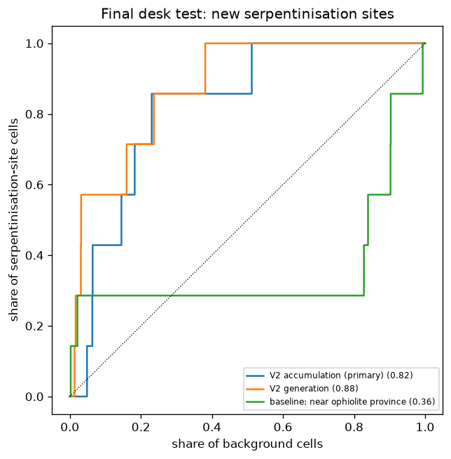

# Final desk test: serpentinisation hydrogen on new literature sites (protocol 2026-11-03)

**Result: INSUFFICIENT SAMPLE** (7 cells, 6 countries; minimum 15 and 4). Descriptive only.

Literature rows 30; measured with coordinates 19; more than 25 km from any EPRI record 7 -> 7 positive scored cells in 6 countries (0 cells unscored).
Background: 18,849 heat-flow cells.

Sites used:

| site                                                 | country       | ophiolite_or_massif                                                | sample_type          |   h2_value | h2_units              | coord_precision          |   km_to_epri |
|:-----------------------------------------------------|:--------------|:-------------------------------------------------------------------|:---------------------|-----------:|:----------------------|:-------------------------|-------------:|
| Vuce spring (VUC)                                    | Kosovo        | Ibar ophiolite (harzburgite), Dinarides/Vardar                     | spring free gas      |   161281   | ppm                   | source-printed           |        271.6 |
| Montagne des Sources spring                          | New Caledonia | New Caledonia Peridotite Nappe (Massif du Sud)                     | spring dissolved gas |       68.4 | µmol/L                | approximate (~10 km)     |         32.2 |
| Poon Bato springs (PB1-PB3), Botolan                 | Philippines   | Zambales ophiolite                                                 | spring dissolved gas |      161.2 | µM                    | approximate (~10 km)     |         36.2 |
| GOR34 springs (Gorsexio), Voltri Massif              | Italy         | Voltri Massif (Gruppo di Voltri) serpentinites, Liguria            | spring free gas      |        1.2 | % of total gas volume | source-printed           |        267.4 |
| BR2 spring (Branega), Voltri Massif                  | Italy         | Voltri Massif (Gruppo di Voltri) serpentinites, Liguria            | spring dissolved gas |        1.8 | µM                    | source-printed           |        269   |
| Fuente Amargosa / Balneario Fuente Amargosa, Tolox   | Spain         | Ronda peridotite (Sierra de las Nieves / Sierra Alpujata massif)   | spring dissolved gas |        1.2 | mg/L                  | named-locality (~1-5 km) |       1244.9 |
| Winter House Canyon springs (WHC1, WHC2), Tablelands | Canada        | Tablelands ophiolite (Bay of Islands), Gros Morne NP, Newfoundland | spring dissolved gas |        1.2 | mg/L                  | source-printed           |        868.5 |

7 positive and 18,849 background cells in 3831 blocks.

| score                             |   AUC |   90% low |   90% high | note                                |
|:----------------------------------|------:|----------:|-----------:|:------------------------------------|
| V2 accumulation (primary)         | 0.822 |     0.679 |      0.912 |                                     |
| V2 generation                     | 0.878 |     0.766 |      0.961 |                                     |
| V1.2 accumulation                 | 0.621 |     0.463 |      0.747 |                                     |
| baseline: near ophiolite province | 0.359 |     0.098 |      0.701 |                                     |
| baseline: sediment thickness      | 0.536 |     0.361 |      0.678 | direction flipped (lower = more H2) |
| baseline: heat flow               | 0.508 |     0.037 |      0.976 | direction flipped (lower = more H2) |

Percentile of each positive cell among background cells (V2 accumulation):

| h3              |   v2_acc |   v2_gen |   d_um_rock |   v2_pct_vs_background | site                                                 | country       |
|:----------------|---------:|---------:|------------:|-----------------------:|:-----------------------------------------------------|:--------------|
| 851f9b1bfffffff |    0.095 |    0.52  |     4457.09 |                     95 | GOR34 springs (Gorsexio), Voltri Massif              | Italy         |
| 8539183bfffffff |    0.087 |    0.207 |     5734.99 |                     94 | Fuente Amargosa / Balneario Fuente Amargosa, Tolox   | Spain         |
| 851f9b0bfffffff |    0.087 |    0.476 |     4447.85 |                     94 | BR2 spring (Branega), Voltri Massif                  | Italy         |
| 856941cbfffffff |    0.06  |    0.476 |      263.21 |                     85 | Poon Bato springs (PB1-PB3), Botolan                 | Philippines   |
| 851ef153fffffff |    0.051 |    0.277 |     3479.29 |                     82 | Vuce spring (VUC)                                    | Kosovo        |
| 859f50b7fffffff |    0.043 |    0.508 |        0    |                     77 | Montagne des Sources spring                          | New Caledonia |
| 851b9e0ffffffff |    0.02  |    0.348 |     3345.61 |                     49 | Winter House Canyon springs (WHC1, WHC2), Tablelands | Canada        |

