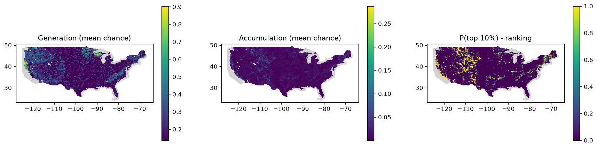

# Phase 4 scores - us

Rules: `configs/scoring_rules.yaml`. Runs: 1000. Cells scored: 212,255; no data: 12,797.
Ranking = share of runs in which a cell is in the top 10% of India for accumulation (source + pathway + reservoir + seal + preservation).

## Spread of the main scores across scored cells

If charge is high almost everywhere, the source no longer separates cells (the v1 problem).

|        |   gen_mean |   charge_mean |   acc_mean |
|:-------|-----------:|--------------:|-----------:|
| p10    |      0.137 |         0.153 |      0.002 |
| median |      0.137 |         0.274 |      0.008 |
| p90    |      0.365 |         0.472 |      0.026 |
| p99    |      0.707 |         0.742 |      0.08  |

## Regional shortlist (cells in the top 10% in at least half the runs)

| state   | tf_class             |   cells |   mean_p_top |   max_p_top |   acc_mean |      lon |    lat |   area_km2 |
|:--------|:---------------------|--------:|-------------:|------------:|-----------:|---------:|-------:|-----------:|
| WY      | Orogenic Belt        |    2009 |        0.938 |           1 |      0.062 | -108.337 | 42.829 |      72525 |
| CA      | Accretionary Complex |    1220 |        0.965 |           1 |      0.068 | -121.16  | 36.719 |      44042 |
| UT      | Shield               |    1082 |        0.93  |           1 |      0.047 | -110.816 | 38.304 |      39060 |
| CA      | Volcanic Arc         |    1013 |        0.901 |           1 |      0.06  | -121.492 | 39.163 |      36569 |
| MT      | Orogenic Belt        |     815 |        0.943 |           1 |      0.063 | -111.489 | 46.928 |      29422 |
| CO      | Orogenic Belt        |     697 |        0.92  |           1 |      0.051 | -106.99  | 39.223 |      25162 |
| MT      | Wide Rift            |     645 |        0.957 |           1 |      0.065 | -112.814 | 45.926 |      23284 |
| ME      | Passive Margin       |     562 |        0.89  |           1 |      0.05  |  -69.503 | 44.85  |      20288 |
| MN      | Craton               |     545 |        0.774 |           1 |      0.037 |  -94.508 | 46.598 |      19674 |
| NM      | Volcanic Arc         |     466 |        0.899 |           1 |      0.049 | -105.416 | 34.234 |      16823 |
| OK      | Volcanic Arc         |     460 |        0.86  |           1 |      0.042 |  -97.634 | 35.074 |      16606 |
| MT      | Craton               |     454 |        0.822 |           1 |      0.037 | -109.394 | 46.966 |      16389 |
| MT      | Volcanic Arc         |     426 |        0.923 |           1 |      0.046 | -109.723 | 47.706 |      15379 |
| WY      | Craton               |     402 |        0.903 |           1 |      0.049 | -105.375 | 43.652 |      14512 |
| TX      | Magmatic Province    |     392 |        0.767 |           1 |      0.033 | -100.564 | 31.777 |      14151 |
| NV      | Wide Rift            |     378 |        0.807 |           1 |      0.037 | -115.468 | 39.293 |      13646 |
| KY      | Magmatic Province    |     363 |        0.794 |           1 |      0.033 |  -85.409 | 37.583 |      13104 |
| VA      | Accretionary Complex |     358 |        0.83  |           1 |      0.037 |  -80.074 | 37.502 |      12924 |
| AZ      | Shield               |     307 |        0.86  |           1 |      0.041 | -111.951 | 36.001 |      11083 |
| OR      | Volcanic Arc         |     300 |        0.896 |           1 |      0.062 | -123.627 | 42.626 |      10830 |
| CO      | Shield               |     279 |        0.866 |           1 |      0.039 | -108.415 | 39.224 |      10072 |
| SD      | Craton               |     273 |        0.914 |           1 |      0.056 | -102.926 | 44.08  |       9855 |
| OR      | Accretionary Complex |     251 |        0.863 |           1 |      0.041 | -123.665 | 44.85  |       9061 |
| AR      | Magmatic Province    |     248 |        0.837 |           1 |      0.037 |  -93.301 | 34.908 |       8953 |
| TX      | Wide Rift            |     245 |        0.859 |           1 |      0.04  | -103.922 | 30.106 |       8844 |

## Generation fairway: cells in the top 10% for source in >= half the runs, by state

| state   |   cells |
|:--------|--------:|
| CA      |    4167 |
| OR      |    2454 |
| MN      |    2096 |
| WA      |    1883 |
| ID      |    1796 |
| NV      |    1507 |
| MT      |    1479 |
| WY      |    1451 |
| TX      |    1432 |
| AZ      |    1383 |
| UT      |    1165 |
| CO      |    1138 |
| NM      |    1138 |
| WI      |    1035 |
| NC      |    1011 |

## Top 30 cells

|   rank_acc | h3              | state   |      lon |     lat |   p_top1_acc |   p_top_acc |   acc_mean |   gen_mean |   charge_mean |   mig_mean |   res_mean |   seal_mean |   pres_mean | main_class   | tf_class      |
|-----------:|:----------------|:--------|---------:|--------:|-------------:|------------:|-----------:|-----------:|--------------:|-----------:|-----------:|------------:|------------:|:-------------|:--------------|
|          1 | 86289255fffffff | MT      | -110.202 | 45.5133 |            1 |           1 |     0.2873 |     0.7773 |        0.7773 |     0.8888 |     0.8137 |      0.7124 |      0.7174 | GRAN         | Orogenic Belt |
|          2 | 8626a2537ffffff | WY      | -107.42  | 42.8618 |            1 |           1 |     0.264  |     0.263  |        0.6544 |     0.8888 |     0.7438 |      0.8508 |      0.7174 | SH           | Orogenic Belt |
|          3 | 86289242fffffff | MT      | -110.118 | 45.5221 |            1 |           1 |     0.2552 |     0.7556 |        0.7556 |     0.8888 |     0.7438 |      0.7124 |      0.7174 | CARB         | Orogenic Belt |
|          4 | 86289254fffffff | MT      | -110.286 | 45.5045 |            1 |           1 |     0.2527 |     0.6679 |        0.6838 |     0.8888 |     0.8137 |      0.7124 |      0.7174 | CARB         | Orogenic Belt |
|          5 | 86289258fffffff | MT      | -109.897 | 45.4961 |            1 |           1 |     0.2509 |     0.3648 |        0.6704 |     0.8888 |     0.7438 |      0.7891 |      0.7174 | VOLC         | Orogenic Belt |
|          5 | 8628925afffffff | MT      | -109.929 | 45.4442 |            1 |           1 |     0.2509 |     0.3648 |        0.6704 |     0.8888 |     0.7438 |      0.7891 |      0.7174 | CARB         | Orogenic Belt |
|          7 | 8626a2a17ffffff | WY      | -106.321 | 42.75   |            1 |           1 |     0.2499 |     0.6679 |        0.6679 |     0.8888 |     0.7438 |      0.7891 |      0.7174 | CARB         | Orogenic Belt |
|          8 | 862892477ffffff | MT      | -110.171 | 45.5652 |            1 |           1 |     0.2378 |     0.6343 |        0.6356 |     0.8888 |     0.7438 |      0.7891 |      0.7174 | CARB         | Orogenic Belt |
|          9 | 8626a2527ffffff | WY      | -107.338 | 42.8688 |            1 |           1 |     0.2351 |     0.263  |        0.6544 |     0.7916 |     0.7438 |      0.8508 |      0.7174 | SH           | Orogenic Belt |
|         10 | 8626a2547ffffff | WY      | -107.189 | 42.7308 |            1 |           1 |     0.2341 |     0.7167 |        0.7182 |     0.8435 |     0.633  |      0.8508 |      0.7174 | SH           | Orogenic Belt |
|         11 | 862892b27ffffff | MT      | -111.247 | 45.2038 |            1 |           1 |     0.2324 |     0.1367 |        0.7222 |     0.8888 |     0.5934 |      0.8508 |      0.7174 | SST          | Wide Rift     |
|         12 | 8626a2a07ffffff | WY      | -106.239 | 42.7562 |            1 |           1 |     0.2323 |     0.2088 |        0.576  |     0.8888 |     0.7438 |      0.8508 |      0.7174 | SST          | Craton        |
|         13 | 8626a2ab7ffffff | WY      | -106.484 | 42.7374 |            1 |           1 |     0.2212 |     0.1367 |        0.5483 |     0.8888 |     0.7438 |      0.8508 |      0.7174 | SH           | Orogenic Belt |
|         14 | 8626a2577ffffff | WY      | -107.239 | 42.7769 |            1 |           1 |     0.22   |     0.5757 |        0.6751 |     0.8435 |     0.633  |      0.8508 |      0.7174 | SH           | Orogenic Belt |
|         15 | 8629a6737ffffff | CA      | -115.831 | 33.6239 |            1 |           1 |     0.219  |     0.7167 |        0.7167 |     0.8888 |     0.8137 |      0.7124 |      0.593  | SST          | Wide Rift     |
|         16 | 8626a2aafffffff | WY      | -106.353 | 42.6974 |            1 |           1 |     0.2188 |     0.6343 |        0.6344 |     0.8194 |     0.7438 |      0.7891 |      0.7174 | SST          | Orogenic Belt |
|         17 | 862818b9fffffff | OR      | -124.072 | 42.747  |            1 |           1 |     0.2187 |     0.857  |        0.857  |     0.8888 |     0.7438 |      0.5383 |      0.7174 | SH           | Volcanic Arc  |
|         18 | 8626a2a0fffffff | WY      | -106.19  | 42.7098 |            1 |           1 |     0.2142 |     0.3648 |        0.576  |     0.8194 |     0.7438 |      0.8508 |      0.7174 | SST          | Orogenic Belt |
|         19 | 862818457ffffff | OR      | -123.326 | 43.0741 |            1 |           1 |     0.2128 |     0.8339 |        0.8339 |     0.8888 |     0.7438 |      0.5383 |      0.7174 | SH           | Volcanic Arc  |
|         20 | 862892467ffffff | MT      | -110.255 | 45.5564 |            1 |           1 |     0.2084 |     0.3648 |        0.5605 |     0.8194 |     0.7438 |      0.8508 |      0.7174 | SH           | Orogenic Belt |
|         21 | 8626a252fffffff | WY      | -107.289 | 42.8229 |            1 |           1 |     0.2072 |     0.3648 |        0.6544 |     0.8194 |     0.633  |      0.8508 |      0.7174 | SH           | Orogenic Belt |
|         22 | 862684a57ffffff | WY      | -106.25  | 41.5942 |            1 |           1 |     0.2066 |     0.6111 |        0.6111 |     0.8888 |     0.7438 |      0.7124 |      0.7174 | SST          | Orogenic Belt |
|         23 | 8626a2aa7ffffff | WY      | -106.403 | 42.7438 |            1 |           1 |     0.2051 |     0.2088 |        0.5483 |     0.8888 |     0.7438 |      0.7891 |      0.7174 | SST          | Orogenic Belt |
|         23 | 8626a6c6fffffff | WY      | -106.792 | 44.0088 |            1 |           1 |     0.2051 |     0.3648 |        0.5085 |     0.8888 |     0.7438 |      0.8508 |      0.7174 | SH           | Orogenic Belt |
|         25 | 86281895fffffff | OR      | -124.048 | 42.4506 |            1 |           1 |     0.2029 |     0.8054 |        0.8054 |     0.8888 |     0.7336 |      0.5383 |      0.7174 | UM           | Volcanic Arc  |
|         26 | 8629a6447ffffff | CA      | -115.709 | 33.5904 |            1 |           1 |     0.2014 |     0.1367 |        0.6513 |     0.8888 |     0.7438 |      0.7891 |      0.593  | SST          | Wide Rift     |
|         27 | 8626a30dfffffff | WY      | -105.602 | 41.8961 |            1 |           1 |     0.1991 |     0.263  |        0.6507 |     0.7916 |     0.633  |      0.8508 |      0.7174 | SH           | Orogenic Belt |
|         28 | 862683d57ffffff | CO      | -107.341 | 39.8605 |            1 |           1 |     0.1981 |     0.5293 |        0.5293 |     0.8888 |     0.7438 |      0.7891 |      0.7174 | CARB         | Orogenic Belt |
|         29 | 8629a646fffffff | CA      | -115.782 | 33.5778 |            1 |           1 |     0.1957 |     0.6679 |        0.6741 |     0.8888 |     0.7336 |      0.751  |      0.593  | MSED         | Wide Rift     |
|         30 | 8626a26cfffffff | WY      | -107.001 | 42.1418 |            1 |           1 |     0.1931 |     0.6111 |        0.6804 |     0.8888 |     0.633  |      0.8508 |      0.593  | SH           | Orogenic Belt |

## How often each rule fired (scored cells)

| component    | factor                 | rule    | when                                                                                                   | cos (low/mode/high)   |   cells |
|:-------------|:-----------------------|:--------|:-------------------------------------------------------------------------------------------------------|:----------------------|--------:|
| generation   | serpentinisation       | 1       | km2_UM_main >= 2                                                                                       | 0.60/0.80/0.95        |     957 |
| generation   | serpentinisation       | 2       | n_um_strong >= 1                                                                                       | 0.55/0.75/0.90        |       0 |
| generation   | serpentinisation       | 3       | km2_UM_any >= 2                                                                                        | 0.40/0.60/0.80        |    2265 |
| generation   | serpentinisation       | 4       | km2_UM_any > 0                                                                                         | 0.25/0.45/0.65        |    1851 |
| generation   | serpentinisation       | 5       | tf_ophiolite >= 0.1                                                                                    | 0.25/0.45/0.65        |     336 |
| generation   | serpentinisation       | 6       | any_UMA > 0 or n_um_moderate >= 1                                                                      | 0.15/0.30/0.50        |       0 |
| generation   | serpentinisation       | 7       | tf_greenstone >= 0.2                                                                                   | 0.10/0.25/0.40        |       0 |
| generation   | serpentinisation       | 8       | f_MAF_I >= 0.05                                                                                        | 0.08/0.20/0.35        |    1105 |
| generation   | serpentinisation       | default | (default)                                                                                              | 0.01/0.03/0.08        |  205741 |
| generation   | iron_oxidation         | 1       | any_BIF > 0                                                                                            | 0.25/0.45/0.65        |     272 |
| generation   | iron_oxidation         | 2       | f_MAF_V >= 0.2                                                                                         | 0.10/0.20/0.35        |   15326 |
| generation   | iron_oxidation         | 3       | f_MAF_D >= 0.5                                                                                         | 0.03/0.08/0.15        |     418 |
| generation   | iron_oxidation         | default | (default)                                                                                              | 0.01/0.02/0.05        |  196239 |
| generation   | radiolysis             | 1       | f_crystalline >= 0.5                                                                                   | 0.08/0.18/0.30        |   16134 |
| generation   | radiolysis             | 2       | f_crystalline >= 0.1                                                                                   | 0.04/0.10/0.18        |   11803 |
| generation   | radiolysis             | default | (default)                                                                                              | 0.01/0.02/0.05        |  184318 |
| generation   | dense_body             | 1       | g_res != g_res                                                                                         | 0.02/0.08/0.25        |       0 |
| generation   | dense_body             | 2       | g_res >= 10                                                                                            | 0.15/0.30/0.45        |   27336 |
| generation   | dense_body             | 3       | g_res >= 5                                                                                             | 0.08/0.18/0.30        |   27937 |
| generation   | dense_body             | default | (default)                                                                                              | 0.01/0.04/0.10        |  156982 |
| migration    | basement_faults        | 1       | d_fault_basement <= 5                                                                                  | 0.50/0.70/0.85        |   30336 |
| migration    | basement_faults        | 2       | d_fault_basement <= 15                                                                                 | 0.30/0.50/0.65        |   28651 |
| migration    | basement_faults        | 3       | d_fault_basement <= 30                                                                                 | 0.15/0.30/0.45        |   19696 |
| migration    | basement_faults        | default | (default)                                                                                              | 0.03/0.10/0.20        |  133572 |
| migration    | crustal_zones          | 1       | d_crustal_zone <= 10                                                                                   | 0.30/0.50/0.70        |   26614 |
| migration    | crustal_zones          | 2       | d_crustal_zone <= 25                                                                                   | 0.15/0.30/0.45        |   24456 |
| migration    | crustal_zones          | default | (default)                                                                                              | 0.01/0.03/0.08        |  161185 |
| migration    | other_faults           | 1       | d_fault_any <= 5                                                                                       | 0.15/0.30/0.45        |   68611 |
| migration    | other_faults           | 2       | d_fault_any <= 15                                                                                      | 0.08/0.18/0.30        |   38318 |
| migration    | other_faults           | default | (default)                                                                                              | 0.01/0.05/0.10        |  105326 |
| reservoir    | sedimentary            | 1       | f_sed_reservoir >= 0.3                                                                                 | 0.35/0.55/0.75        |   85991 |
| reservoir    | sedimentary            | 2       | f_sed_reservoir >= 0.1                                                                                 | 0.20/0.35/0.50        |   19165 |
| reservoir    | sedimentary            | default | (default)                                                                                              | 0.01/0.05/0.10        |  107099 |
| reservoir    | basin_depth            | 1       | bd_depth_m >= 500 and bd_depth_m <= 6000                                                               | 0.25/0.40/0.60        |  124054 |
| reservoir    | basin_depth            | 2       | bd_depth_m > 6000                                                                                      | 0.15/0.25/0.40        |   12245 |
| reservoir    | basin_depth            | default | (default)                                                                                              | 0.01/0.05/0.15        |   75956 |
| reservoir    | fractured_basement     | 1       | f_hardrock >= 0.5 and d_fault_any <= 10                                                                | 0.15/0.30/0.45        |   27320 |
| reservoir    | fractured_basement     | 2       | f_hardrock >= 0.5                                                                                      | 0.05/0.12/0.20        |    8467 |
| reservoir    | fractured_basement     | default | (default)                                                                                              | 0.01/0.03/0.08        |  176468 |
| seal         | evaporite              | 1       | any_EVAP >= 0.05                                                                                       | 0.50/0.70/0.85        |   11860 |
| seal         | evaporite              | default | (default)                                                                                              | 0.00/0.01/0.03        |  200395 |
| seal         | shale                  | 1       | f_SH >= 0.3                                                                                            | 0.30/0.50/0.70        |   77259 |
| seal         | shale                  | 2       | f_SH >= 0.1                                                                                            | 0.15/0.30/0.45        |   16339 |
| seal         | shale                  | default | (default)                                                                                              | 0.01/0.03/0.08        |  118657 |
| seal         | low_permeability_cover | 1       | f_MAF_D >= 0.5                                                                                         | 0.15/0.30/0.45        |     442 |
| seal         | low_permeability_cover | 2       | f_QUAT >= 0.5 and bd_depth_m >= 500                                                                    | 0.10/0.20/0.35        |   22661 |
| seal         | low_permeability_cover | 3       | f_MSED >= 0.3                                                                                          | 0.08/0.18/0.30        |    9460 |
| seal         | low_permeability_cover | default | (default)                                                                                              | 0.01/0.05/0.12        |  179692 |
| preservation | tectonic_stability     | 1       | d_neotectonic <= 5                                                                                     | 0.30/0.50/0.70        |   17157 |
| preservation | tectonic_stability     | 2       | d_neotectonic <= 15                                                                                    | 0.45/0.65/0.80        |   15538 |
| preservation | tectonic_stability     | default | (default)                                                                                              | 0.60/0.80/0.90        |  179560 |
| preservation | orogenic_activity      | 1       | tf_class.str.contains('Himalaya\|Accretionary\|Accreted\|Schuppen\|Eastern Boundary Thrust', na=False) | 0.40/0.60/0.80        |   16953 |
| preservation | orogenic_activity      | default | (default)                                                                                              | 0.85/0.95/1.00        |  195302 |

