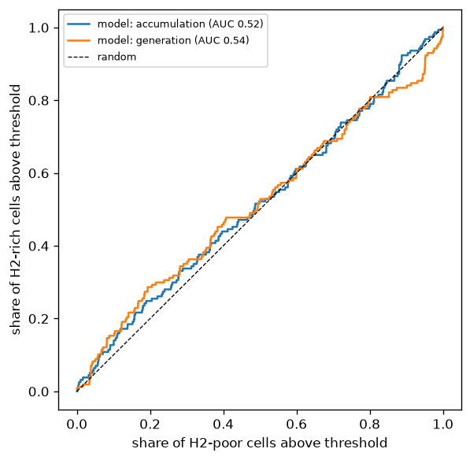

# US validation result (protocol 2026-11-02, rules v1.2 unchanged)

Cells: 2,586 (157 positive, 2429 negative) in 235 spatial blocks.

## Verdict: **FAIL**

| criterion | required | result |
|:--|:--|:--|
| AUC of accumulation | >= 0.65 | 0.517 |
| lower 90% bound | > 0.5 | 0.478 |
| margin over best baseline (sediment thickness) | >= 0.05 | -0.123 (90% low -0.175) |

Share of positive cells in the top 10% of well cells by accumulation: 13% (random: 10%).

## All scores

| score                          |   AUC |   90% low |   90% high | note                                |
|:-------------------------------|------:|----------:|-----------:|:------------------------------------|
| model: accumulation (acc_mean) | 0.517 |     0.478 |      0.555 |                                     |
| model: generation (gen_mean)   | 0.545 |     0.509 |      0.585 |                                     |
| baseline: near ultramafic rock | 0.509 |     0.45  |      0.568 |                                     |
| baseline: sediment thickness   | 0.64  |     0.594 |      0.684 | direction flipped (lower = more H2) |
| baseline: heat flow            | 0.532 |     0.475 |      0.592 |                                     |
| benchmark: USGS PP 1900 total  | 0.508 |     0.463 |      0.558 |                                     |
| benchmark: USGS PP 1900 source | 0.556 |     0.508 |      0.61  |                                     |

## Sensitivity (reported only)

| variant              |   cells |   positive |   AUC accumulation |   best baseline AUC | verdict   |
|:---------------------|--------:|-----------:|-------------------:|--------------------:|:----------|
| positive >= 1 mol%   |    2529 |         63 |              0.523 |               0.647 | fail      |
| negative <= 0.1 mol% |    2017 |        157 |              0.527 |               0.643 | fail      |

## West vs east

| half          |   cells |   positive |   AUC accumulation |
|:--------------|--------:|-----------:|-------------------:|
| west of 100 W |    1188 |         84 |              0.471 |
| east of 100 W |    1398 |         73 |              0.565 |

