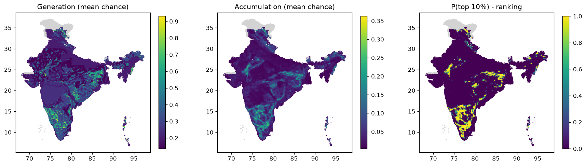

# Phase 4 scores - india, rules v2 (scoring_rules_v2.yaml)

Rules: `configs/scoring_rules_v2.yaml`. Runs: 1000. Cells scored: 87,495; no data: 3,371.
Ranking = share of runs in which a cell is in the top 10% of India for accumulation (source + pathway + reservoir + seal + preservation).

## Spread of the main scores across scored cells

If charge is high almost everywhere, the source no longer separates cells (the v1 problem).

|        |   gen_mean |   charge_mean |   acc_mean |
|:-------|-----------:|--------------:|-----------:|
| p10    |      0.136 |         0.197 |      0.011 |
| median |      0.245 |         0.29  |      0.029 |
| p90    |      0.416 |         0.569 |      0.107 |
| p99    |      0.729 |         0.761 |      0.209 |

## Regional shortlist (cells in the top 10% in at least half the runs)

| state             | tf_class                                                                                 |   cells |   mean_p_top |   max_p_top |   acc_mean |    lon |    lat |   area_km2 |
|:------------------|:-----------------------------------------------------------------------------------------|--------:|-------------:|------------:|-----------:|-------:|-------:|-----------:|
| KARNATAKA         | Unclassified Gneissic Complex                                                            |    1194 |        0.921 |           1 |      0.158 | 76.281 | 14.444 |      43103 |
| ANDHRA PRADESH    | Unclassified Gneissic Complex                                                            |     573 |        0.914 |           1 |      0.152 | 78.527 | 14.83  |      20685 |
| TAMIL NADU        | Unclassified Gneissic Complex                                                            |     556 |        0.957 |           1 |      0.184 | 77.945 | 11.41  |      20072 |
| KARNATAKA         | Greenstone and allied Supracrustal Belts of Southern-Central and Eastern India           |     456 |        0.882 |           1 |      0.169 | 76.003 | 14.605 |      16462 |
| JHARKHAND         | Unclassified Gneissic Complex                                                            |     445 |        0.94  |           1 |      0.164 | 85.058 | 23.894 |      16064 |
| TAMIL NADU        | High Grade Gneissic Granulite terrain of Southern, Central and Eastern India             |     412 |        0.925 |           1 |      0.169 | 77.99  | 11.548 |      14873 |
| RAJASTHAN         | Proterozoic Fold Belt                                                                    |     346 |        0.943 |           1 |      0.178 | 73.895 | 25.022 |      12491 |
| KERALA            | High Grade Gneissic Granulite terrain of Southern, Central and Eastern India             |     268 |        0.941 |           1 |      0.156 | 76.5   | 10.462 |       9675 |
| ANDHRA PRADESH    | Greenstone and allied Supracrustal Belts of Southern-Central and Eastern India           |     208 |        0.958 |           1 |      0.163 | 79.332 | 15.122 |       7509 |
| MAHARASHTRA       | Unclassified Gneissic Complex                                                            |     186 |        0.916 |           1 |      0.15  | 79.512 | 20.605 |       6715 |
| RAJASTHAN         | Unclassified Gneissic Complex                                                            |     160 |        0.874 |           1 |      0.153 | 74.414 | 25.375 |       5776 |
| TELANGANA         | Unclassified Gneissic Complex                                                            |     152 |        0.882 |           1 |      0.142 | 78.651 | 16.79  |       5487 |
| LADAKH            | Late to Post Tectonic Granitoid                                                          |     152 |        0.872 |           1 |      0.151 | 77.996 | 33.994 |       5487 |
| MADHYA PRADESH    | Unclassified Gneissic Complex                                                            |     145 |        0.858 |           1 |      0.15  | 79.485 | 22.481 |       5234 |
| KERALA            | Unclassified Gneissic Complex                                                            |     135 |        0.963 |           1 |      0.172 | 76.519 | 10.682 |       4874 |
| CHHATTISGARH      | Unclassified Gneissic Complex                                                            |     125 |        0.868 |           1 |      0.144 | 82.323 | 21.311 |       4512 |
| KARNATAKA         | Composite Batholithic Complex                                                            |     110 |        0.949 |           1 |      0.159 | 77.125 | 13.927 |       3971 |
| JHARKHAND         | Proterozoic Fold Belt                                                                    |     103 |        0.904 |           1 |      0.152 | 85.928 | 23.018 |       3718 |
| WEST BENGAL       | Unclassified Gneissic Complex                                                            |     103 |        0.877 |           1 |      0.154 | 86.514 | 23.353 |       3718 |
| ODISHA            | Unclassified Gneissic Complex                                                            |      98 |        0.871 |           1 |      0.14  | 82.802 | 19.218 |       3538 |
| RAJASTHAN         | Late to Post Tectonic Granitoid                                                          |      95 |        0.902 |           1 |      0.165 | 73.345 | 25.155 |       3430 |
| MADHYA PRADESH    | Proterozoic Fold Belt                                                                    |      93 |        0.874 |           1 |      0.145 | 81.666 | 24.032 |       3357 |
| ANDHRA PRADESH    | Shelf facies cover in Intracratonic sag (including low - moderate strained Folded Cover) |      90 |        0.898 |           1 |      0.144 | 79.247 | 15.105 |       3249 |
| ARUNACHAL PRADESH | Older folded cover sequence overprinted by Himalayan fold - thrust movement              |      82 |        0.871 |           1 |      0.14  | 93.832 | 28.011 |       2960 |
| ARUNACHAL PRADESH | Late to Post Tectonic Granitoid                                                          |      78 |        0.92  |           1 |      0.144 | 95.818 | 28.506 |       2816 |

## Generation fairway: cells in the top 10% for source in >= half the runs, by state

| state          |   cells |
|:---------------|--------:|
| KARNATAKA      |    1822 |
| JHARKHAND      |     998 |
| ODISHA         |     738 |
| TAMIL NADU     |     717 |
| ANDHRA PRADESH |     684 |
| CHHATTISGARH   |     682 |
| RAJASTHAN      |     559 |
| LADAKH         |     339 |
| TELANGANA      |     333 |
| KERALA         |     309 |
| MADHYA PRADESH |     289 |
| MAHARASHTRA    |     263 |
| WEST BENGAL    |     199 |
| MANIPUR        |     136 |
| ASSAM          |      96 |

## Top 30 cells

|   rank_acc | h3              | state          |     lon |     lat |   p_top1_acc |   p_top_acc |   acc_mean |   gen_mean |   charge_mean |   mig_mean |   cover_mean | main_class   | tf_class                                                                       |
|-----------:|:----------------|:---------------|--------:|--------:|-------------:|------------:|-----------:|-----------:|--------------:|-----------:|-------------:|:-------------|:-------------------------------------------------------------------------------|
|          1 | 866033c47ffffff | TAMIL NADU     | 77.1964 | 11.4253 |            1 |           1 |     0.3628 |     0.9066 |        0.9066 |     0.8884 |       0.4504 | GNS          | Unclassified Gneissic Complex                                                  |
|          1 | 866033c4fffffff | TAMIL NADU     | 77.138  | 11.4259 |            1 |           1 |     0.3628 |     0.9066 |        0.9066 |     0.8884 |       0.4504 | GNS          | Unclassified Gneissic Complex                                                  |
|          3 | 86618d0f7ffffff | TAMIL NADU     | 78.9554 | 12.2992 |            1 |           1 |     0.3208 |     0.9066 |        0.9066 |     0.7855 |       0.4504 | GNS          | High Grade Gneissic Granulite terrain of Southern, Central and Eastern India   |
|          4 | 866013847ffffff | KARNATAKA      | 75.5984 | 13.6131 |            1 |           1 |     0.3201 |     0.9047 |        0.9047 |     0.7855 |       0.4504 | MAF_V        | Greenstone and allied Supracrustal Belts of Southern-Central and Eastern India |
|          5 | 866032a17ffffff | TAMIL NADU     | 77.7843 | 11.5234 |            1 |           1 |     0.3187 |     0.7963 |        0.7963 |     0.8884 |       0.4504 | GRAN         | Composite Batholithic Complex                                                  |
|          6 | 863ca50afffffff | UTTAR PRADESH  | 82.8446 | 24.5183 |            1 |           1 |     0.3176 |     0.8979 |        0.8979 |     0.7855 |       0.4504 | MSED         | Proterozoic Fold Belt                                                          |
|          7 | 866032a97ffffff | TAMIL NADU     | 77.8165 | 11.6805 |            1 |           1 |     0.3174 |     0.8353 |        0.8353 |     0.8436 |       0.4504 | GRAN         | Composite Batholithic Complex                                                  |
|          7 | 866032067ffffff | TAMIL NADU     | 77.8469 | 11.7327 |            1 |           1 |     0.3174 |     0.8353 |        0.8353 |     0.8436 |       0.4504 | GRAN         | Composite Batholithic Complex                                                  |
|          9 | 863db4667ffffff | RAJASTHAN      | 74.0392 | 25.8625 |            1 |           1 |     0.3169 |     0.792  |        0.792  |     0.8884 |       0.4504 | GNS          | Ophiolite / Melange                                                            |
|          9 | 863db4677ffffff | RAJASTHAN      | 74.0124 | 25.8109 |            1 |           1 |     0.3169 |     0.792  |        0.792  |     0.8884 |       0.4504 | GNS          | Proterozoic Fold Belt                                                          |
|         11 | 8660331afffffff | TAMIL NADU     | 77.0513 | 11.4791 |            1 |           1 |     0.3134 |     0.7832 |        0.7832 |     0.8884 |       0.4504 | GNS          | High Grade Gneissic Granulite terrain of Southern, Central and Eastern India   |
|         11 | 866033117ffffff | TAMIL NADU     | 77.0797 | 11.4265 |            1 |           1 |     0.3134 |     0.7832 |        0.7832 |     0.8884 |       0.4504 | GNS          | Unclassified Gneissic Complex                                                  |
|         13 | 866033c6fffffff | TAMIL NADU     | 77.1664 | 11.3733 |            1 |           1 |     0.3127 |     0.5891 |        0.7815 |     0.8884 |       0.4504 | GNS          | Unclassified Gneissic Complex                                                  |
|         13 | 866033c67ffffff | TAMIL NADU     | 77.2248 | 11.3726 |            1 |           1 |     0.3127 |     0.4054 |        0.7815 |     0.8884 |       0.4504 | GNS          | Unclassified Gneissic Complex                                                  |
|         15 | 863c8c177ffffff | ODISHA         | 86.3333 | 21.9177 |            1 |           1 |     0.3123 |     0.8827 |        0.8827 |     0.7855 |       0.4504 | MAF_V        | Gently folded volcano - sedimentary pile in intracratonic aborted rift         |
|         16 | 863ca9787ffffff | WEST BENGAL    | 86.9725 | 23.5223 |            1 |           1 |     0.3109 |     0.8787 |        0.8787 |     0.7855 |       0.4504 | GNS          | Unclassified Gneissic Complex                                                  |
|         17 | 8660ac15fffffff | KARNATAKA      | 75.6997 | 15.0087 |            1 |           1 |     0.3084 |     0.8117 |        0.8117 |     0.8436 |       0.4504 | MAF_V        | Unclassified Gneissic Complex                                                  |
|         18 | 8660ac117ffffff | KARNATAKA      | 75.9038 | 15.0636 |            1 |           1 |     0.3057 |     0.7638 |        0.7638 |     0.8884 |       0.4504 | GNS          | Unclassified Gneissic Complex                                                  |
|         19 | 86618d66fffffff | TAMIL NADU     | 78.6307 | 12.4611 |            1 |           1 |     0.3039 |     0.8589 |        0.859  |     0.7855 |       0.4504 | GNS          | Unclassified Gneissic Complex                                                  |
|         20 | 8660115b7ffffff | KARNATAKA      | 75.7401 | 13.3555 |            1 |           1 |     0.2976 |     0.8408 |        0.8411 |     0.7855 |       0.4504 | MAF_V        | Greenstone and allied Supracrustal Belts of Southern-Central and Eastern India |
|         21 | 8660102efffffff | KARNATAKA      | 75.7979 | 13.3558 |            1 |           1 |     0.2974 |     0.8408 |        0.8408 |     0.7855 |       0.4504 | MAF_V        | Greenstone and allied Supracrustal Belts of Southern-Central and Eastern India |
|         22 | 866033c77ffffff | TAMIL NADU     | 77.2549 | 11.4246 |            1 |           1 |     0.2971 |     0.8353 |        0.8359 |     0.7888 |       0.4504 | GNS          | Unclassified Gneissic Complex                                                  |
|         23 | 8660366cfffffff | TAMIL NADU     | 78.4051 | 11.5678 |            1 |           1 |     0.2969 |     0.8353 |        0.8354 |     0.7888 |       0.4504 | GNS          | Unclassified Gneissic Complex                                                  |
|         24 | 8660a564fffffff | ANDHRA PRADESH | 77.1944 | 15.0803 |            1 |           1 |     0.2966 |     0.7411 |        0.7411 |     0.8884 |       0.4504 | GNS          | Greenstone and allied Supracrustal Belts of Southern-Central and Eastern India |
|         25 | 863db4287ffffff | RAJASTHAN      | 74.093  | 25.9659 |            1 |           1 |     0.2963 |     0.8035 |        0.8035 |     0.8189 |       0.4504 | CARB         | Proterozoic Fold Belt                                                          |
|         25 | 863db4297ffffff | RAJASTHAN      | 74.0661 | 25.9142 |            1 |           1 |     0.2963 |     0.8035 |        0.8035 |     0.8189 |       0.4504 | MAF_V        | Proterozoic Fold Belt                                                          |
|         27 | 86618d0cfffffff | TAMIL NADU     | 78.836  | 12.3006 |            1 |           1 |     0.2957 |     0.8353 |        0.8359 |     0.7855 |       0.4504 | GNS          | High Grade Gneissic Granulite terrain of Southern, Central and Eastern India   |
|         27 | 86618d0dfffffff | TAMIL NADU     | 78.867  | 12.353  |            1 |           1 |     0.2957 |     0.8353 |        0.8359 |     0.7855 |       0.4504 | GNS          | High Grade Gneissic Granulite terrain of Southern, Central and Eastern India   |
|         29 | 866032087ffffff | TAMIL NADU     | 77.999  | 11.9938 |            1 |           1 |     0.2956 |     0.8353 |        0.8354 |     0.7855 |       0.4504 | GNS          | Alkaline Plutonic Complex                                                      |
|         30 | 86603621fffffff | TAMIL NADU     | 78.3378 | 11.1473 |            1 |           1 |     0.2931 |     0.8283 |        0.8283 |     0.7855 |       0.4504 | GNS          | High Grade Gneissic Granulite terrain of Southern, Central and Eastern India   |

## How often each rule fired (scored cells)

| component   | factor           | rule    | when                                                                   | cos (low/mode/high)   |   cells |
|:------------|:-----------------|:--------|:-----------------------------------------------------------------------|:----------------------|--------:|
| generation  | serpentinisation | 1       | km2_UM_main >= 2                                                       | 0.60/0.80/0.95        |     297 |
| generation  | serpentinisation | 2       | n_um_strong >= 1                                                       | 0.55/0.75/0.90        |      48 |
| generation  | serpentinisation | 3       | km2_UM_any >= 2                                                        | 0.40/0.60/0.80        |     349 |
| generation  | serpentinisation | 4       | km2_UM_any > 0                                                         | 0.25/0.45/0.65        |    2491 |
| generation  | serpentinisation | 5       | tf_ophiolite >= 0.1                                                    | 0.25/0.45/0.65        |      38 |
| generation  | serpentinisation | 6       | any_UMA > 0 or n_um_moderate >= 1                                      | 0.15/0.30/0.50        |     340 |
| generation  | serpentinisation | 7       | tf_greenstone >= 0.2                                                   | 0.10/0.25/0.40        |    2334 |
| generation  | serpentinisation | 8       | f_MAF_I >= 0.05                                                        | 0.08/0.20/0.35        |     556 |
| generation  | serpentinisation | default | (default)                                                              | 0.01/0.03/0.08        |   81042 |
| generation  | iron_oxidation   | 1       | any_BIF > 0                                                            | 0.25/0.45/0.65        |    2838 |
| generation  | iron_oxidation   | 2       | f_MAF_V >= 0.2                                                         | 0.10/0.20/0.35        |    1152 |
| generation  | iron_oxidation   | 3       | f_MAF_D >= 0.5                                                         | 0.03/0.08/0.15        |   14037 |
| generation  | iron_oxidation   | default | (default)                                                              | 0.01/0.02/0.05        |   69468 |
| generation  | radiolysis       | 1       | f_crystalline >= 0.5                                                   | 0.08/0.18/0.30        |   22193 |
| generation  | radiolysis       | 2       | f_crystalline >= 0.1                                                   | 0.04/0.10/0.18        |    4710 |
| generation  | radiolysis       | default | (default)                                                              | 0.01/0.02/0.05        |   60592 |
| generation  | dense_body       | 1       | g_res != g_res                                                         | 0.02/0.08/0.25        |   39225 |
| generation  | dense_body       | 2       | g_res >= 10                                                            | 0.15/0.30/0.45        |    6318 |
| generation  | dense_body       | 3       | g_res >= 5                                                             | 0.08/0.18/0.30        |    6229 |
| generation  | dense_body       | default | (default)                                                              | 0.01/0.04/0.10        |   35723 |
| migration   | basement_faults  | 1       | d_fault_basement <= 5                                                  | 0.50/0.70/0.85        |    3590 |
| migration   | basement_faults  | 2       | d_fault_basement <= 15                                                 | 0.30/0.50/0.65        |    7401 |
| migration   | basement_faults  | 3       | d_fault_basement <= 30                                                 | 0.15/0.30/0.45        |   10117 |
| migration   | basement_faults  | default | (default)                                                              | 0.03/0.10/0.20        |   66387 |
| migration   | crustal_zones    | 1       | d_crustal_zone <= 10                                                   | 0.30/0.50/0.70        |    7892 |
| migration   | crustal_zones    | 2       | d_crustal_zone <= 25                                                   | 0.15/0.30/0.45        |    7683 |
| migration   | crustal_zones    | default | (default)                                                              | 0.01/0.03/0.08        |   71920 |
| migration   | other_faults     | 1       | d_fault_any <= 5                                                       | 0.15/0.30/0.45        |   12477 |
| migration   | other_faults     | 2       | d_fault_any <= 15                                                      | 0.08/0.18/0.30        |   19869 |
| migration   | other_faults     | default | (default)                                                              | 0.01/0.05/0.10        |   55149 |
| cover       | thin_cover       | 1       | bd_depth_m <= 2000 or (bd_depth_m != bd_depth_m and f_hardrock >= 0.5) | 0.30/0.45/0.60        |   39853 |
| cover       | thin_cover       | 2       | bd_depth_m <= 4000                                                     | 0.15/0.30/0.45        |    5321 |
| cover       | thin_cover       | 3       | bd_depth_m > 4000                                                      | 0.05/0.12/0.25        |    3187 |
| cover       | thin_cover       | default | (default)                                                              | 0.10/0.25/0.40        |   39134 |

